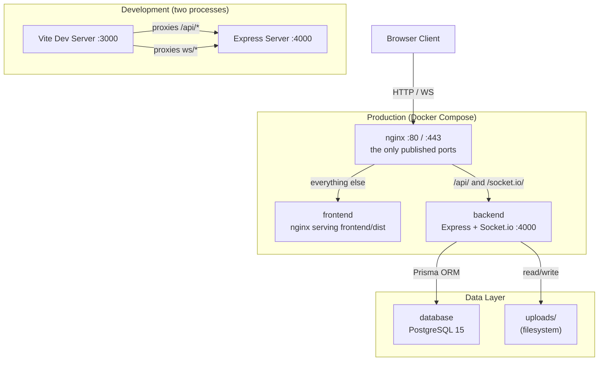
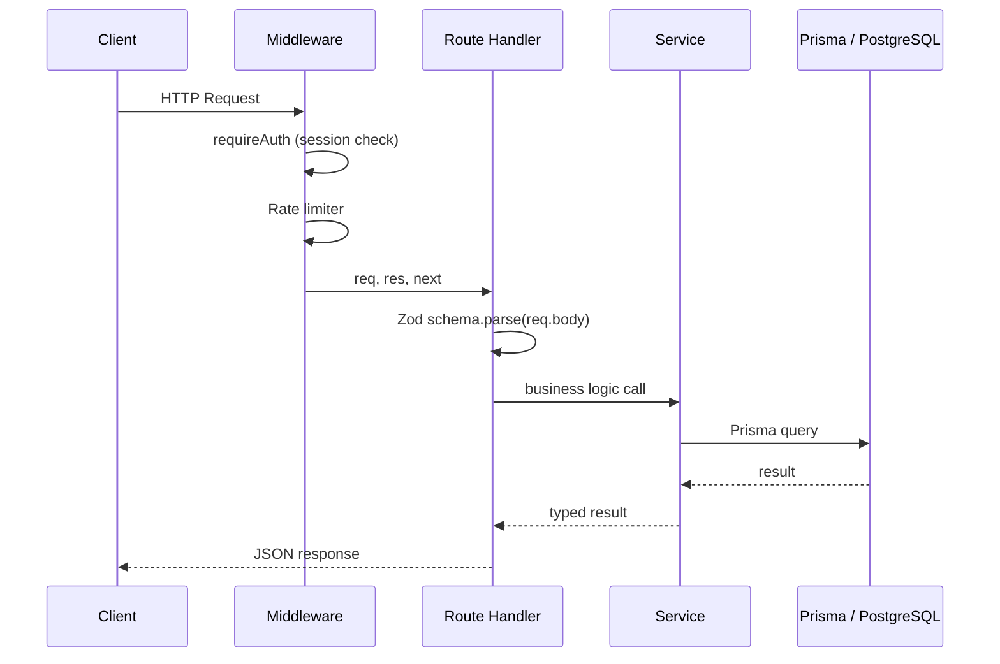
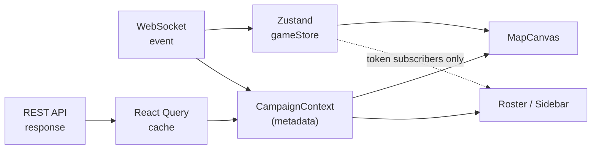
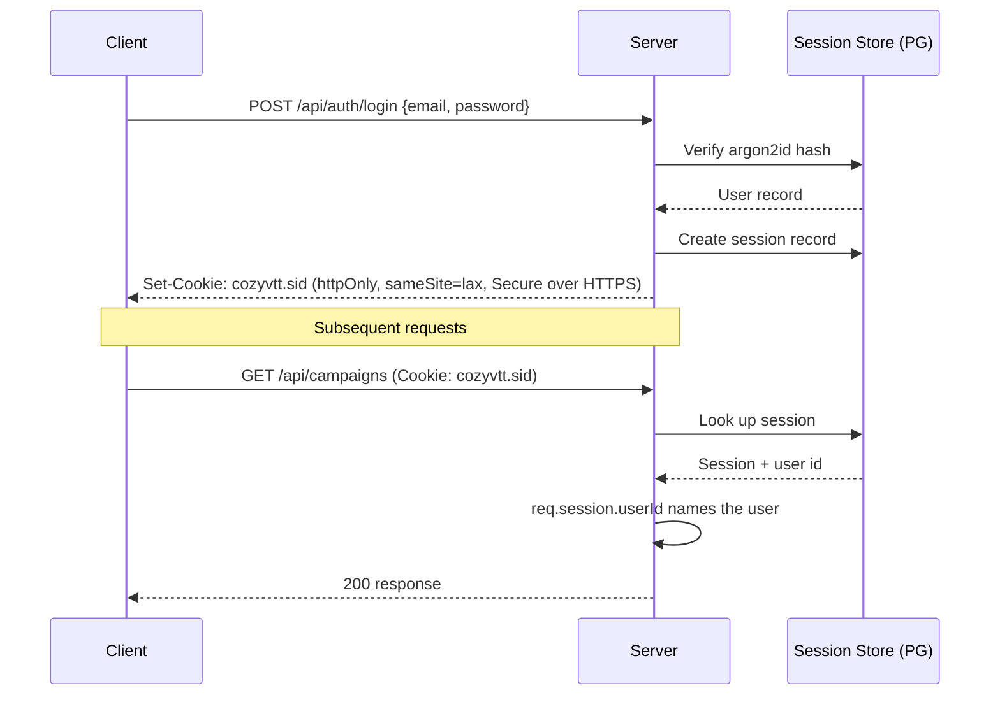
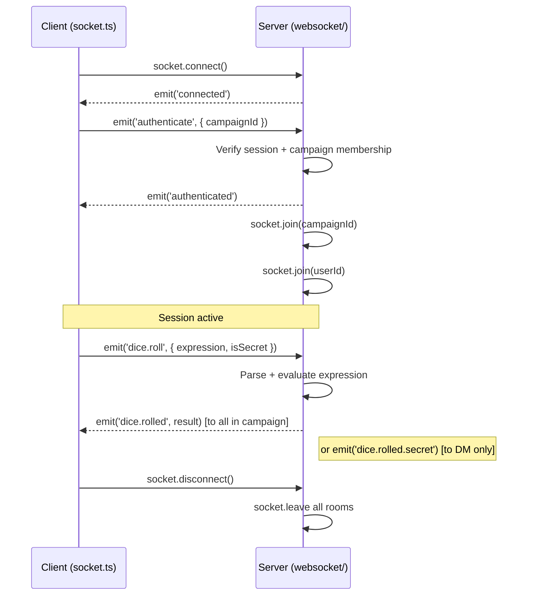

# CozyVTT — Architecture

This document describes the system architecture, data models, and key design decisions in CozyVTT.

---

## Table of Contents

1. [High-Level Overview](#high-level-overview)
2. [Backend Architecture](#backend-architecture)
3. [Frontend Architecture](#frontend-architecture)
4. [Database Schema](#database-schema)
5. [Authentication & Authorization](#authentication--authorization)
6. [WebSocket Architecture](#websocket-architecture)
7. [File Storage](#file-storage)
8. [Game Systems Architecture](#game-systems-architecture)
9. [Key Design Decisions](#key-design-decisions)

---

## High-Level Overview

CozyVTT is a monorepo containing a Node.js/Express API backend and a React SPA frontend. The backend serves the REST API, the Socket.io live connection and the uploaded files; it does not serve the built frontend. In production the Docker stack (`docker-compose.yml`) runs four containers on one internal network: `nginx` is the only one with published ports, it sends `/api/` and `/socket.io/` to `backend` and everything else to `frontend`, which serves the built SPA, and `database` is PostgreSQL, reachable from the backend alone. Without Docker, a host nginx does the public `nginx` container's job and serves `frontend/dist` itself (the deployment guide's manual install). In development, a Vite dev server runs separately and proxies API/WebSocket traffic to the backend.



### The bundled nginx

The Docker production stack (`docker-compose.yml`) puts two nginx servers in front of the backend. The `nginx` service is the public entry: it sends `/api/` and `/socket.io/` to the backend and everything else to the `frontend` container, whose own nginx serves the built SPA with the page's security headers (`frontend/nginx.conf`, `frontend/security-headers.conf`). The public one is made from the files in `nginx/`:

| File | What it does |
|---|---|
| `nginx.conf` | A template the image's entrypoint renders (only the variables in `NGINX_ENVSUBST_FILTER`): body size, compression, resolver, which addresses are believed about the visitor's address and protocol, the plain-HTTP server, and last `include /etc/nginx/cozyvtt.d/*.conf` |
| `locations.conf` | The proxying rules, included by the plain-HTTP server and by the HTTPS server a self-hoster writes from the deployment guide's example |
| `trusted-proxies.envsh` | Sourced by the entrypoint before it renders the template: turns `NGINX_TRUSTED_PROXIES` from `.env` into `set_real_ip_from` lines and the `geo` list that decides whether `X-Forwarded-Proto` is believed |
| `conf.d/` | The self-hoster's own files, HTTPS among them, mounted at `/etc/nginx/cozyvtt.d`; git ignores all but its README |
| `certs/` | Their certificates; git ignores them |

The first three are mounted one file each, and a single-file mount keeps the file it found when the container was made, so `NGINX_CONF_STAMP` on the service has to change with any of them; `backend/src/__tests__/keepInStep.test.ts` holds it to their hash.

---

## Backend Architecture

### Layer Structure

```
src/
├── server.ts          Entry point: builds the app, attaches Socket.io, starts listening
├── app.ts             createApp: every middleware, gate, router and error handler, in
│                      order; the integration tests build their app with it too
├── config/            Configuration loading (env vars, validation)
├── middleware/
│   ├── auth.ts        Session-cookie authentication: requireAuth, requireAdmin, requireRole
│   ├── rbac.ts        Campaign roles: loadCampaignMembership, requireDM, requireDMOrPlayer
│   │                  and requireCampaignMember, read from the database, never from the request
│   ├── compose.ts     The guards routes actually use, composed: authenticated, adminOnly,
│   │                  campaignMember, campaignDM, campaignDMOrPlayer
│   ├── setup.ts       The setup gate: everything but /api/setup and /health is refused
│   │                  until setup has run; asks the database only until it hears it has
│   ├── passwordChange.ts  Gates every route until an admin-issued password is replaced
│   ├── adminMfa.ts        Gates an administrator without MFA past their deadline (services/adminMfaPolicy.ts);
│   │                      re-reads the admin's role on every request
│   ├── originCheck.ts     Refuses a change a browser sent from another site (HTTP and the socket handshake)
│   ├── restoreGate.ts     Refuses API requests while a backup restore replaces the database
│   ├── bodyParsers.ts     JSON body parsing and its 1 MB limit (a form-encoded body is not read), shared with the test app
│   ├── errorHandler.ts    The JSON error answer for anything a route did not catch
│   ├── failureLimiter.ts  The sign-in limiter: counts only wrong answers, per address
│   ├── authLimiters.ts    The per-account sign-in limit and the signed-in password-check limit
│   ├── invitationEmailLimiter.ts  How many invitation emails a DM may have the instance send
│   ├── leftNotesDownloadLimiter.ts  How often a user may download all the notes of a campaign they have left
│   ├── campaignArchiveLimits.ts  Per-user hourly limits on previewing, importing
│   │                  and exporting campaign archives, one archive at a time
│   │                  (the other HTTP limiters are declared beside their routes,
│   │                  and the general /api limiter in app.ts)
│   ├── fileValidation.ts  Content check: an upload must be a type its asset kind allows
│   └── upload.ts      Multer configuration
├── routes/            HTTP route handlers
│   ├── auth.ts        Login, logout, register, password reset
│   ├── users.ts       User CRUD (admin only)
│   ├── campaigns.ts   Campaign CRUD + membership
│   ├── campaignMacros.ts Saved dice macros per campaign
│   ├── leftCampaigns.ts A removed member's own notes and macros, read only
│   ├── campaignDocuments.ts Documents shared with a campaign
│   ├── characters.ts  Character CRUD + assignment
│   ├── maps.ts        Map and token management
│   ├── creatures.ts   Creature template CRUD, SRD seeding, favorites
│   ├── assets.ts      File upload and retrieval
│   ├── invitations.ts Campaign invitation lifecycle
│   ├── setup.ts       First-run setup wizard; asks for the setup token (services/setupToken.ts)
│   │                  and runs services/setup.ts, one transaction for the first admin and the settings
│   ├── config.ts      Public client config (upload limits)
│   └── admin.ts       Admin: stats, settings, users, backups, logs
├── services/          Business logic (called by routes and WebSocket handlers)
├── validators/        Zod validation schemas (one per domain, incl. game-systems/)
├── websocket/
│   ├── events.ts      Connection orchestrator: auth, disconnect, ping, and
│   │                  registration of every per-domain handler module
│   ├── shared.ts      Rate limiters and the per-user socket ceilings, the
│   │                  Token shape, fog helpers
│   ├── auth.ts        Socket session + campaign-membership authentication
│   ├── utils.ts       System-message / broadcast helpers
│   └── handlers/      One module per domain — tokens, dice, chat, spirit,
│                      vibe, maps, atmosphere, characters, initiative,
│                      walls, fog, lights, exploration, pings
├── utils/
│   ├── dice-parser.ts    mathjs-based dice expression evaluator
│   ├── spirit-layer.ts   Spirit-layer + dynamic-lighting token filtering
│   ├── visibilityRule.ts What a viewer makes out of a point (shared, see Vision model)
│   ├── tokenCentre.ts    The point a token sees from and is seen at (shared)
│   ├── raycasting.ts     Line-of-sight polygons (shared, byte-identical with the client)
│   ├── spatialIndex.ts   Wall grid for large maps (shared)
│   ├── styleAllowlists.ts CSS-bound values the server accepts and the client re-checks (shared)
│   ├── asset-urls.ts     Asset URL normalization
│   ├── fileUtils.ts      Upload paths + MAX_*_SIZE_MB limit resolution
│   ├── proxyLimits.ts    Proxy body-cap parsing and startup warnings
│   ├── byteRange.ts      HTTP Range header reading for audio streaming
│   ├── shutdown.ts       SIGTERM/SIGINT: stop taking requests, let a dashboard backup finish
│   │                     (up to 10 minutes, services/backupsInProgress.ts), close sockets,
│   │                     database and session store, then exit; an error nothing caught is
│   │                     logged before the process exits 1
│   └── logger.ts         Winston logger configuration
└── types/             Shared TypeScript interfaces
```

Real-time gameplay logic lives in the per-domain `websocket/handlers/*` modules; each exports a `registerXxxHandlers(io, socket)` called once per connection so per-connection state (throttles, rate-limit buckets) is preserved. `events.ts` is a thin orchestrator that wires them together.

### Request Flow



---

## Frontend Architecture

### Layer Structure

```
src/
├── main.tsx           Entry point — BrowserRouter wrapper
├── App.tsx            Route definitions, auth guards, lazy page loading
├── contexts/
│   ├── AuthContext.tsx    User auth state, login/logout/register actions
│   ├── WebSocketContext.tsx  Socket.io connection lifecycle and event subscriptions
│   ├── CampaignContext.tsx   Per-campaign metadata (campaign, current map, vibe, session status, roster)
│   ├── ThemeContext.tsx      The theme and font in force, and the instance's default
│   ├── ThemeSyncBridge.tsx   Applies the signed-in user's saved theme over the default, and clears it at sign-out
│   └── ToastContext.tsx      The small notices the app shows
├── stores/
│   └── gameStore.ts   Zustand store for live socket-fed session state (token positions, combat/initiative, hover cross-highlight)
├── lib/
│   └── queryClient.ts  React Query client configuration
├── pages/             One file per route (thin; delegates to components, contexts, and query hooks)
├── components/
│   ├── ui/            Shared UI primitives (Button, Modal, Input, Field, Tooltip)
│   ├── campaign/      Campaign page panels (ChatPanel, DiceRoller, SessionSidebar, MapCanvas, etc.)
│   │   └── map/       MapCanvas render layers, coordinate conversions, fog and wall selection, vision cache, explored memory, preview selection, the held-token release, and animation/render-loop hooks
│   ├── character-sheets/  Game system sheet renderers
│   ├── common/        Reusable primitives (Toast, ConfirmDialog, EmptyState, etc.)
│   └── admin/         Admin panel tabs
├── services/
│   ├── api.ts         Axios-based REST API client (singleton)
│   ├── socket.ts      Socket.io client wrapper (singleton)
│   ├── unsavedWork.ts What a lost session does while an editor has unsaved changes
│   ├── pageLoad.ts    The full page loads the API client sends a page on with (sign in, required pages)
│   ├── signInNotice.ts  The reason a sign-in ended, carried to the sign-in page across that load
│   ├── sessionKeepAlive.ts  Pings the session from the game table and from editors with unsaved changes
│   └── auth.service.ts  Auth-specific API calls
├── hooks/
│   └── queries/       React Query hooks wrapping the REST services (useCampaign, useCharacters, useAssets, …)
├── types/             TypeScript type definitions mirroring backend types
├── utils/             Client-side helpers (validation, formatting)
└── styles/            Global CSS, Tailwind directives, effect stylesheets
```

### State Management

CozyVTT uses three complementary state layers, each with a clear boundary. The rule of thumb: **React Query owns server resources, Zustand owns live socket-fed session state, and React Context owns app/session wiring — never two layers for the same datum.**

| Layer | Owns | Examples |
|-------|------|----------|
| **React Query** (`@tanstack/react-query`) | Server resources fetched over REST | Campaign lists/detail, characters, assets, map metadata |
| **Zustand** (`stores/gameStore.ts`) | Live, high-frequency state fed by WebSocket events | Token positions and list, combat/initiative, hover cross-highlight (walls, fog and lights are still MapCanvas-local; walls additionally keep their own undo/redo history) |
| **React Context** | App/session wiring and metadata | Auth state, socket connection, campaign metadata + vibe/session status |

A page that changes a server resource away from the page that lists it updates that list's cache itself. The characters list, for instance, is served from cache for 30 seconds, so the full-page character editor and the templates page write what they saved or created into it with `storeCharacterInList` (`hooks/queries`); otherwise the Characters page would show a new character late, or an old name. The characters list and the character template list hold no sheets (the server lists them without `data`), so a page that opens, exports, copies or edits one fetches it by id first.

The split exists for performance. Live token movement is written to the Zustand store from **outside** React, so a `token.moved` event re-renders only the components subscribed to that token (the map canvas) — the roster, initiative tracker, and side panels don't re-render per movement frame. All three context provider values are memoized so unrelated socket traffic doesn't cascade re-renders through the campaign subtree.

### Theming

Every color in the themed UI comes from a CSS variable, so switching themes repaints the app without
re-rendering anything. Tailwind maps each token with `rgb(var(--color-x) / <alpha-value>)`
([tailwind.config.js](../frontend/tailwind.config.js)), which is why opacity modifiers such as
`bg-danger/10` still follow the theme.

| Group | Tokens | Use for |
|---|---|---|
| Brand / accent | `brand`, `brand-dark`, `accent`, `accent-hover`, `accent-text` | Fills: buttons, borders, highlights |
| Text | `ink`, `ink-secondary`, `ink-muted` | Body, secondary and muted text |
| Surfaces | `canvas`, `surface`, `surface-light`, `surface-dark`, `paper` | Page and panel backgrounds |
| **Ink variants** | `brand-ink`, `accent-ink`, `spirit-ink`, `danger-ink`, `success-ink`, `warning-ink`, `info-ink` | **Text** in that color |
| States | `danger`, `success`, `warning`, `info`, `spirit` | Status fills, borders, tints |

**Two rules keep themes readable:**

1. **Use `-ink` when the color is text.** `accent` is a fill — as text it measured as low as 1.84:1.
   The `-ink` variants are derived per theme by `deriveReadableTokens`
   ([themes.ts](../frontend/src/themes.ts)) via `ensureReadable`
   ([utils/color.ts](../frontend/src/utils/color.ts)), which walks the color's lightness until it
   clears WCAG AA against that theme's surfaces. Authored values that already pass are left alone.
   Custom themes get the same treatment, so a user-picked palette cannot produce unreadable text.
2. **Never use a raw Tailwind palette color on a themed surface.** `bg-red-50` stays pale pink on a
   dark theme. Use the state tokens, or the `.alert-*` / `.badge-*` classes in
   [index.css](../frontend/src/index.css).

Both rules are enforced by tests rather than review:
`utils/__tests__/themes.contrast.test.ts` checks every preset theme against every text/background
pair the UI renders, and `utils/__tests__/themeTokens.test.ts` fails if raw palette colors appear
outside the two exempt areas (character sheets, which are deliberately styled as light "paper" cards,
and the dark DM map overlays).

### Data Flow (Campaign Page)



---

## Database Schema

The full Prisma schema is at `backend/prisma/schema.prisma`. Below is an entity relationship diagram of every model, with the fields that matter here. A test checks it against the schema, so a model, field or relation that does not exist cannot stay in it. The login sessions are not a model: `connect-pg-simple` keeps them in a `session` table of its own (see Authentication below), and the `Session` below is a game session.

```mermaid
erDiagram
    User {
        string id PK
        string email
        string displayName
        PlatformRole platformRole
        bool globalAssetManager
        bool templateEditor
        bool isApproved
        bool mfaEnabled
        bool mustChangePassword
        string avatarUrl
        string bio
    }

    PasswordResetToken {
        string id PK
        string userId FK
        datetime expiresAt
        bool used
    }

    Campaign {
        string id PK
        string name
        string description
        GameSystem gameSystem
        CampaignStatus status
        string ownerId FK
        string currentMapId FK
        json vibeSettings
        string spiritLayerStyle
        bool spiritLayerEnabled
        bool chatCooldownEnabled
    }

    CampaignMembership {
        string id PK
        string userId FK
        string campaignId FK
        CampaignRole role
        string[] characterIds
    }

    CampaignInvitation {
        string id PK
        string campaignId FK
        string userId FK
        InvitationStatus status
        datetime expiresAt
    }

    Character {
        string id PK
        string userId FK
        string campaignId FK
        string name
        GameSystem gameSystem
        json data
        string tokenImageUrl
    }

    CharacterTemplate {
        string id PK
        string name
        string description
        GameSystem gameSystem
        json data
        string tokenImageUrl
        string createdById FK
    }

    Map {
        string id PK
        string campaignId FK
        string name
        string imageUrl
        int width
        int height
        int gridSize
        json tokens
        json wallSegments
        json lights
        json fogData
        bool lightingEnabled
        bool fogEnabled
        bool explorationEnabled
    }

    MapExploration {
        string id PK
        string mapId FK
        string userId FK
        json explored
    }

    Asset {
        string id PK
        AssetType type
        AssetScope scope
        string uploadedById FK
        string campaignId FK
        string filename
        string originalName
        int fileSize
        string mimeType
        string thumbnailPath
        string[] tags
    }

    Message {
        string id PK
        string campaignId FK
        string userId FK
        MessageType type
        string content
        json metadata
    }

    DiceRoll {
        string id PK
        string campaignId FK
        string userId FK
        string expression
        int result
        bool secret
    }

    Session {
        string id PK
        string campaignId FK
        int sessionNumber
        datetime startedAt
        datetime endedAt
        json savedState
        string notes
    }

    PersonalNote {
        string id PK
        string userId FK
        string campaignId FK
        string title
        string content
        datetime updatedAt
    }

    DiceMacro {
        string id PK
        string userId FK
        string campaignId FK
        string name
        string expression
        datetime createdAt
    }

    CreatureTemplate {
        string id PK
        string name
        string gameSystem
        string source
        string challengeRating
        string creatureType
        json statBlock
        json size
        string disposition
        string displayMode
        string imageUrl
        string campaignId FK
    }

    CreatureFavorite {
        string id PK
        string campaignId FK
        string userId FK
        string creatureId FK
        datetime createdAt
    }

    TokenTemplate {
        string id PK
        string campaignId FK
        string createdById FK
        string name
        string type
        json size
        json statBlock
    }

    CampaignDocument {
        string id PK
        string campaignId FK
        string assetId FK
        string linkedById FK
        datetime createdAt
    }

    SystemSettings {
        string id PK
        bool setupCompleted
        string instanceName
        bool allowRegistration
        bool requireAdminApproval
        string themeId
        string fontId
    }

    SystemLog {
        string id PK
        LogLevel level
        string message
        json context
        datetime createdAt
    }

    User ||--o{ Campaign : "owns"
    User ||--o{ CampaignMembership : "belongs to"
    Campaign ||--o{ CampaignMembership : "has"
    User ||--o{ CampaignInvitation : "is invited"
    Campaign ||--o{ CampaignInvitation : "has"
    User ||--o{ PasswordResetToken : "has"
    User ||--o{ Character : "owns"
    User ||--o{ CharacterTemplate : "published"
    Campaign ||--o{ Character : "has assigned"
    Campaign ||--o{ Map : "has"
    Map ||--o{ Campaign : "is shown by"
    Map ||--o{ MapExploration : "remembered in"
    User ||--o{ MapExploration : "explores"
    Campaign ||--o{ Message : "has"
    User ||--o{ Message : "writes"
    Campaign ||--o{ DiceRoll : "has"
    User ||--o{ DiceRoll : "rolls"
    Campaign ||--o{ Session : "has"
    Campaign ||--o{ PersonalNote : "has"
    User ||--o{ PersonalNote : "writes"
    Campaign ||--o{ DiceMacro : "has"
    User ||--o{ DiceMacro : "saves"
    User ||--o{ Asset : "uploaded"
    Campaign ||--o{ Asset : "scoped to"
    Campaign ||--o{ CreatureTemplate : "scoped to"
    CreatureTemplate ||--o{ CreatureFavorite : "favorited as"
    User ||--o{ CreatureFavorite : "has favorites"
    Campaign ||--o{ CreatureFavorite : "scoped to"
    User ||--o{ TokenTemplate : "made"
    Campaign ||--o{ TokenTemplate : "has"
    Campaign ||--o{ CampaignDocument : "shares"
    Asset ||--o{ CampaignDocument : "shared as"
    User ||--o{ CampaignDocument : "linked by"
```



### Key Schema Notes

- **Token data is stored as JSON inside `Map.tokens`** — tokens are not a separate table. This simplifies real-time updates (the whole token list is atomically replaced on moves).
- **Walls, lights and fog are JSON on the map row too** (`Map.wallSegments`, `Map.lights`, `Map.fogData`). A write to any of these columns, or to `Map.tokens`, reads the whole value, changes it and writes it back, so it runs inside `withMapsLocked` (`utils/mapTokens.ts`): a transaction holding a PostgreSQL advisory lock on the map, which reads the value through the transaction after taking the lock. Edits sent together, from the socket or the REST routes, then apply one after another instead of the later write dropping the earlier change. Every other edit of the map waits while the lock is held, so slow work belongs before it is taken, and so does any read through the global `prisma` client, which would hold a second connection while the transaction holds one. A player's door toggle, for instance, works out their line of sight first (`doorSightFor` in `websocket/handlers/walls.ts`), then judges the door as it reads it under the lock.
- **Character sheet data is stored as JSON in `Character.data`** — the schema is validated at the API layer by game-system-specific Zod schemas (a Flexible sheet, with no game system, by `flexible.schema.ts`) but stored untyped in Postgres. This allows flexible incremental saves. Every text field a sheet stores has a length limit, from `validators/game-systems/sheetLimits.ts`, which the frontend keeps an identical copy of for its editors. Counts are limited where a list could grow without bound in play: Flexible sections, stats, list entries, table rows, columns and cells; D&D 5e spell slots (0 to 20 a level); and the D&D 5e manual bonuses (-30 to +30). Most other lists on typed sheets are bounded only by the 1 MB request body.
- **`vibeSettings` and `Session.savedState` are JSON columns** — used to persist complex nested state that changes frequently.
- **`CreatureTemplate` uses two scopes** — SRD creatures have `campaignId = null` (global, read-only) while custom creatures have a campaign FK. The `source` field distinguishes them (`'srd'` vs `'custom'`).
- **`DiceMacro` is private to whoever saved it**, on the same terms as `PersonalNote` and enforced the same way. Its `expression` is validated when written by rolling it and discarding the result, so a stored macro is always one the roller accepts — ordered by `createdAt` rather than `updatedAt` because these are buttons, and editing one must not move it.
- **`PersonalNote` is private to its author** — every query is scoped by both `campaignId` and the signed-in `userId`, and a note belonging to someone else answers 404 rather than 403 so the response cannot confirm that it exists. Nobody reads these but the person who wrote them, the DM included. Removing a member keeps both kinds of row; `GET /api/campaigns/left`, `/left/:campaignId`, `/left/:campaignId/notes` and `/left/:campaignId/notes/:noteId` let the author read their own afterwards, only while they are not a member, and deleting the campaign deletes them. The lists carry titles only. A note's text comes from `/notes/:noteId` one note at a time, or from `/left/:campaignId/notes` for all of a campaign's notes in one answer, which the Download button uses: it is written out ten notes at a time, since a campaign can hold 200 notes of 100,000 characters, and limited to 60 requests an hour per user.
- **`CreatureFavorite` is a per-campaign, per-user join table** — with a unique constraint on `(campaignId, userId, creatureId)` to prevent duplicate favorites. Cascade deletes ensure cleanup when creatures, users, or campaigns are removed.
- **`CampaignDocument` shares a document with a campaign without copying it.** A document is an ordinary `Asset` of type `DOCUMENT`; the join row, unique on `(campaignId, assetId)`, is what lets a `USER`-scoped rulebook be read by the members of every campaign it is linked to. It is the one place the asset read rule looks beyond scope: `canReadAsset` is the single function both the serving route and the linking route consult, so a DM cannot link a file they could not read themselves; and linking further requires the document to be the DM's own or `GLOBAL`, so a share into one campaign cannot be forwarded by a member of it who runs another. Unlinking revokes access; deleting the asset removes its links, and deleting the campaign leaves the document intact.

---

## Authentication & Authorization

### Session Authentication

CozyVTT uses **express-session** with **connect-pg-simple** to store sessions in PostgreSQL. This means sessions survive server restarts and scale to multiple processes.



A session expires after an hour with no requests (`SESSION_MAX_AGE`; "Remember me" makes it 30 days), and each request starts the hour again. It also ends `REMEMBER_ME_MAX_AGE` (30 days) after it was made, however active: `signedInAt` is set at sign-in and checked by the guards and the socket handshake (`services/signedIn.ts`), and a session from before the field existed is stamped when next seen. Each sign-in removes the account's oldest sessions beyond 20 (`capLoginSessions`), and the session row holds the user id and role, `signedInAt`, `mustChangePassword` and the MFA pending fields. Two kinds of activity make no requests, so they ping `GET /api/auth/ping` every ten minutes through `services/sessionKeepAlive.ts`: the campaign page while its live connection is up, and a character sheet editor while it holds unsaved changes (at once when the changes appear too, since the hour may be nearly up). When a request answers 401 on a page that needs a session, the API client's interceptor normally sends the browser to the sign-in page, carrying the page as `?next=` so signing in returns to it (`utils/returnTo.ts` follows only a path on this origin that is not a public page). While a character sheet editor holds unsaved changes it does not: `services/unsavedWork.ts` keeps the page where it is and marks the browser signed out, and the editor says so, with a link to sign in in a new tab. The session cookie is shared between tabs, so the editor's Save works once that sign-in is done. A sign-in that reached its age limit answers with `code: 'SIGN_IN_EXPIRED'`, and its sentence is kept in `sessionStorage` (`services/signInNotice.ts`) for the sign-in page to show once. The calls that check the current password or a code while signed in (change password, delete account, MFA disable, backup codes, MFA setup, an email change) answer 401 for a wrong one; they pass `skipAuthRedirect`, and their forms show the message. The sign-in check at page load treats only a refusal (a 4xx other than 408 and 429) as signed out; no answer or a server error shows "Can't reach the server" on protected pages and retries. A sign-in that succeeds meanwhile cancels the retry and clears the notice, and the answer to a check still on its way is dropped (`authEpoch` in `contexts/AuthContext.tsx`).

### Role-Based Authorization

Authorization is enforced at two levels, both by middleware composed in `middleware/compose.ts` and named in the route declaration:

1. **Platform level** — `requireAdmin` (as `adminOnly`) on admin routes, which checks the role stored in the session
2. **Campaign level** — `loadCampaignMembership` reads the caller's `CampaignMembership` for the `:campaignId` in the URL from the database, and `requireDM`, `requireDMOrPlayer` or `requireCampaignMember` then judge its role. The role comes from that row, never from the request

```typescript
// Example: a DM-only route. campaignDM is [requireAuth, loadCampaignMembership, requireDM];
// a non-member gets 403 "You are not a member of this campaign", a player or
// spectator 403 "This action requires Dungeon Master (DM) role".
router.put('/:campaignId', campaignDM, async (req: AuthenticatedRequest, res: Response) => {
  // req.campaignMembership is set and has role DM
});
```

### Ownership is a separate axis from the DM role

`Campaign.ownerId` and `CampaignMembership.role === 'DM'` are different facts.
They name the same person in a campaign whose creator still runs it, which is
most of them — and that coincidence is why five call sites independently worked
out "the DM" by looking up the owner, and only diverged once the DM seat became
movable (`PUT /api/campaigns/:id/dm`).

Decide **"is this user the DM?"** from the membership, never from `ownerId`.
Ownership gates exactly one thing, deleting the campaign, so that the
destructive power stays with whoever created it and a handover can never lock an
owner out. The frontend asks `src/utils/campaignRoles.ts`, which exists so the
answer has one home rather than five.

### Roles are a snapshot on an open socket

`socket.role` is read once, when the socket authenticates to a campaign, and
trusted by every gated handler thereafter — the right place to read it from,
since a handler must never take a role off the wire, but it means the value
goes stale if the role changes underneath it. A DM transfer therefore updates
connected sockets in place (`applyRoleToLiveSockets`) and broadcasts
`campaign.dm.transferred`, rather than waiting for a reconnect. REST needs no
equivalent: `loadCampaignMembership` reads the membership per request.

Taking access away works the same way. Removing a member and deleting a
campaign make the affected sockets leave the room and forget the campaign
(`clearCampaignFromLiveSockets`, `clearDeletedCampaignFromLiveSockets`), and
ending a sign-in closes its sockets (`endLiveSockets`; a restore ends every
socket with `endEveryLiveSocket`). Each socket is first sent
`campaign.access.revoked` with the reason (`removed`, `campaign-deleted`,
`signed-out`). On the client, `socket.ts` stops reconnecting after it, the
connection badge shows the reason, and `hooks/useAccessRevoked.ts` on the
campaign page goes to the dashboard with a notice, or to the sign-in page,
unless an editor holds unsaved changes.

### MFA (TOTP)

MFA uses the `otplib` library for TOTP secrets, setup links and verification. A new secret is 20 random bytes written in base32; the secrets stored before 1.5.2, made by an earlier library as 20 printable characters in base32, are read the same way. A code must be exactly six digits, and anything else is refused before it is checked. One 30-second step either side of the current one is accepted, for clock drift. Every check goes through `utils/totp.ts`, which accepts each code once: it remembers the last 30-second step accepted for each account and refuses a code from that step or an earlier one, at sign-in, when MFA is turned on and when it is turned off. That record is kept in the backend process's memory, which is sound for the single production process; a restart forgets it, and more than one backend process would need it moved to the database. The sign-in code step is rate limited per address and, separately, per account. Backup codes are hashed with Argon2id, like passwords, and shown to the user only once. A code that matches is removed with one conditional `UPDATE ... array_remove` that only succeeds while that hash is still stored, so two sign-ins racing on a code cannot both use it and cannot write back a list that brings another code back.

---

## WebSocket Architecture

### Connection Lifecycle



### Reconnecting

socket.io retries a dropped connection for as long as it takes, backing off
to 30 seconds between tries, and the client builds a new socket the same way
after the server closes one (a restart closes every socket). A socket the
server refuses before it joins (too many tabs, a sign-in it no longer
accepts) is retried only five times in a row. Leaving the campaign page
(`socketClient.disconnect()`) ends all of this: it forgets the campaign, cancels
the pending retry and the connect under way, whether or not a socket is held.
`WebSocketContext` follows
every socket from the moment it is built (`socketClient.onCreated`), counts
each `authenticated` as a join (`joinedEpoch`, which drives the catch-up
after every rejoin, Retry included) and as connected, retries a first connect
that left no socket behind, and reconnects at once when the page becomes
visible again.

### Room Structure

Sockets join two rooms, keyed by raw id (no prefix):

- `<campaignId>` — all connected members of a campaign
- `<userId>` — per-user room for targeted broadcasts (e.g., secret dice results)

### Spirit Layer Security

Token data is filtered **per-client** before being broadcast. The server maintains two views of the token list:

- **DM view** — all tokens, both layers, all metadata including DM notes
- **Player view** — the tokens on the plane the player is on (the spirit layer once they have crossed over or the DM has revealed it to everyone, otherwise the material plane), never a hidden token, and, when dynamic lighting is on, only tokens the visibility rule says the player sees. Each token is then trimmed for that recipient by `tokenForRecipient`, which copies only the fields listed in `PLAYER_TOKEN_FIELDS` (`tokenMask.ts`), so a field added to tokens later reaches no player until it is listed: no `notes` or `statBlock`, `hp` only for their own token or one whose HP bar is on, `sightRadius` and `creatureTemplateId` only for their own, and an obscured token they do not control masked by `tokenMask.ts`

This filtering lives in `src/utils/spirit-layer.ts` and is applied before each client receives its payload: by the map fetch and the token update's reply over REST, and by the token, spirit, `map.change` and initiative handlers over the socket. The initiative order is projected per recipient through the same role filter, so a hidden or off-plane combatant, or one on a map the campaign is not showing, is absent and a combatant's name, picture and hit points are what the map would send that player; the lighting rule is not applied to the order, so a combatant out of a player's sight is still listed. For fan-out to many players, visibility is resolved for all viewers in a fixed number of queries per event rather than one lookup per socket.

Walls and lights are not filtered by sight, since each browser works out its own sight from the walls, but two of their details are the DM's: `wallsSentTo` sends anyone but the DM a `door-locked` door as `door-closed`, and `lightsSentTo` sends them only the lights that are on (`spirit-layer.ts`). Every path that sends walls or lights applies them: the map fetch and `map.changed` (`filterMapData`), `walls:request` and `lights:request`, the REST reads, and the live edits, which go out per reader through `emitToMapReadersAs` (`websocket/utils.ts`), so a light turned on or off reaches a player as `light:added` or `light:removed` (`lightChangeSentTo`). A player is sent nothing for a change that leaves their copy as it was: a closed door locked or unlocked (`wallChangeSentTo`), a light that is off added, changed or deleted (`lightReachesPlayers`, `lightChangeSentTo`, `lightRemovalSentTo`), or a whole list replaced with one that is the same for them (`wallsReplacedSentTo`, `lightsReplacedSentTo`), since the event alone would tell them something had happened there. On a lit map the same tests (`wallChangeReachesPlayers`, `lightChangeReachesPlayers`, `lightReachesPlayers`, `wallListChangeReachesPlayers`, `lightListChangeReachesPlayers`) decide whether players are sent the map again afterwards (`resendSightAfterChange` in `websocket/shared.ts`), which would tell them the same.

### Vision model

Dynamic lighting asks one question of every point on the map: how well does this viewer make it out? The answer is decided once, in `visibilityRule.ts`, and used on both sides:

- the **server** (`filterTokensByLighting`) sends a player a token only if the rule says its centre is seen, judged from the centres of the player's own tokens;
- the **client** (`drawLights.ts`, `drawWalls.ts`) draws the coverage mask in the rule's tiers and shows a door only where the rule says the player can see it.

The rule, in order: walls first, always (nothing outside a viewer's line of sight is seen, lit or not); then the map's **Global Illumination** flag (everything in sight is bright); then darkvision and light, which add up the way the mask is composited: bright is 1.0, dim is 0.5, so dim + dim is bright and darkvision in dim light is bright. A viewer's own square is always dim: you know where you stand. Explored memory is never an input: the map image is already in every client, so what to grey in is a rendering concern; token positions are not.

Three files exist once in each package and must stay byte-identical: `visibilityRule.ts`, `raycasting.ts` (the line-of-sight polygons, with perimeter samples so a capped view is a disc) and `spatialIndex.ts`. So must `tokenMask.ts`, the obscured-token mask the server applies and the DM's preview reuses. `backend/src/utils/__tests__/visionParity.test.ts` fails if any copy drifts, the same way `characterHp.ts` and `styleAllowlists.ts` are held in step. Both sides take a token's centre from `tokenCentre.ts`, kept identical by `keepInStep.test.ts`: a token covers its height in rows upward from its grid position, so its centre is half that height below its top edge, which a second formula once got wrong for tokens two squares or taller. The rule takes its point-in-polygon test as a parameter, so it depends on neither side's raycaster module.

A fifth shared file, `__fixtures__/vision-scenarios.json`, holds worked scenarios (a torch's rings, a sealed lit room, an open door, two viewers combining, no viewer at all, a Huge token against a wall). The backend suite checks which tokens each scenario sends; the frontend suite checks the tier at each sample point and that a token is seen exactly when it is sent. A scenario the two sides answer differently fails one of them.

### WebSocket Event Reference

See [API_REFERENCE.md](API_REFERENCE.md#websocket-events) for the full event listing.

---

## File Storage

Uploaded files are stored on the local filesystem under `backend/uploads/`:

```
uploads/
  maps/         global/{uuid}.{ext}                  Global and personal maps
                global/thumb_{uuid}.{ext}            Thumbnail, longest edge 512 px
                campaigns/{campaignId}/{uuid}.{ext}  A campaign's own, thumbnails beside them
  tokens/       global/…, campaigns/{campaignId}/…   As maps
  audio/        global/…, campaigns/{campaignId}/…   No thumbnails
  avatars/      {uuid}.{ext}
  documents/    global/…, campaigns/{campaignId}/…   No thumbnails
  temp/         Campaign imports still in progress
    uvtt/       Universal VTT uploads waiting their turn (one is read at a time across the server, then removed)
```

`Asset.filePath` and `Asset.thumbnailPath` record where each file is. Nothing
else refers to a file on disk.

Instance backups (`backup-{timestamp}.zip`) are kept outside this tree, in
`backend/backups/` or `BACKUP_DIR`, which may not point inside the uploads
directory (`backend/src/utils/backupDir.ts`).

A restore runs one at a time, and `services/restoreState.ts` knows whether
one is running and whether it has started replacing the database. From then
until it ends, nothing may reach the database: the restore has already closed
every socket, `websocket/events.ts` refuses a new connection, and
`middleware/restoreGate.ts`, mounted on `/api` ahead of the session
middleware, answers every request 503. A write waiting behind the load's locks
would otherwise land on the restored rows. Its upload waits in the backups
folder as `restore-temp-<uuid>.zip`; one a stopped backend left is removed at
start.

### Upload Pipeline

1. **Multer** receives the multipart upload and streams to a temp file
2. **Content check** (`file-type` library, `middleware/fileValidation.ts`): the file's own bytes decide its type, and that type must be one the asset's kind allows (a map picture is PNG, JPEG or WebP, whatever the browser declared or the name says). Only a file `file-type` cannot identify falls through to a per-format check, and that check is positive rather than by extension: an audio upload named `.mp3` must start with an ID3 tag or an MPEG frame sync, and a document named `.txt` or `.md` must decode as UTF-8 with no NUL or control bytes. Anything else it cannot identify is refused, so an executable renamed `.md` fails here. The stored file's extension is changed to match the detected type, and the detected type is the MIME type the `Asset` row records.
3. **Size limit check** — configurable per asset type via environment variables
4. **Sharp** makes a thumbnail in the picture's own format (for maps and tokens), through `openPicture` (see [Decoding pictures](#decoding-pictures))
5. File is moved to its final location; the `Asset` record is created in the database

Editing a text or Markdown document never writes over the file. The new text
goes to a temporary file in the same folder, which is flushed to disk and then
renamed over the original (`writeFileAtomically` in
`backend/src/utils/fileUtils.ts`), so a crash leaves the old text or the new.
A save that finds the row deleted once it has written removes its file.

### Leftover files

A file can still end up with no row: an asset delete removes the row first and
the file second, so a file that cannot be removed is left; a restore copies the
backup's files over the uploads folder whatever the restored database names;
a crash can fall between a file being written and its row. `services/orphanedFiles.ts`
finds them for the Admin Panel (`GET /api/admin/orphaned-files`). It walks the
five asset folders (not `temp/`, nor anything else in the uploads folder) and
lists each regular file whose name is not the file name of any row's
`filePath` or `thumbnailPath`. Stored names are generated UUIDs, and matching on
the name alone keeps a file whose row was written under another uploads path,
as a restored backup's rows can be. Files changed in the last hour are left
out: an upload lands in `maps/global/` before its type is known and is moved
and recorded after, and an import writes its files before its rows commit. Listing changes
nothing; `DELETE /api/admin/orphaned-files` takes the paths the admin saw and
deletes each one only if a fresh scan still lists it.

### Security Headers

Two policies, because two different servers answer. `backend/src/app.ts`
(helmet) covers what the backend sends, which in the production stack is `/api`
and `/socket.io`. The app page comes from the frontend container, so its
headers live in `frontend/security-headers.conf` and travel with it, including
when a self-hoster removes the bundled proxy and points their own at that
container. A Content-Security-Policy on a JSON response governs nothing, which
is why the page had no protection until the second file existed.

The page's policy is the wider of the two, since it also covers the page's
stylesheets, fonts and the document reader's frame. Nothing it allows is on
another site: the typefaces are part of the app (`frontend/src/assets/fonts`,
one `@font-face` per family and character range, so a browser fetches only
what the page uses), and the build inlines the smallest as `data:` addresses.
It is strict where it counts, `script-src 'self'` with no
`unsafe-inline`, which the built page allows because Vite emits no inline
script. It deliberately omits `upgrade-insecure-requests`, since CozyVTT is
commonly served over plain HTTP on a home network and that directive would
break such an instance.

nginx does not inherit `add_header` into a location that sets one of its own,
and `try_files` routes `/` through the `= /index.html` block, so the headers
are included per location rather than declared once at server level. A test
asserts that per block.

The app page's fallback is `try_files $uri /index.html` with no `$uri/`, and a
request that names a folder of the build is rewritten to `/index.html` first.
The build keeps its scripts and styles in a folder called `assets/`, which is
also the address of the Asset Library page: `$uri/` matched that folder and
nginx refused to list it, so reloading `/assets` gave `403 Forbidden`.
`frontend/src/__tests__/spaFallback.test.ts` walks the config for such paths.

### Serving Audio

Ambient audio is not relayed through the server. The DM's choice is broadcast as
a URL and each player's browser fetches the file itself, so a track must be
readable by every member while it plays. `canReadAsset` grants exactly that: the
asset id recorded in the campaign's `vibeSettings.atmosphereAudio` is readable by
that campaign's members for as long as it is recorded. Because setting a track is
therefore an act of sharing, the socket handler checks the DM can read it first,
and never as an admin. It is also the only writer of that setting that takes an
id from a client: the campaign settings routes carry the stored value through
untouched, because they cannot make that check. A campaign import never keeps
the archive's id either. It names only the copy of the track it has just
imported into the new campaign, an asset of that campaign uploaded by the
importer, or no track. The route sends the `Content-Type` from the file's
validated extension, never the uploader-supplied `mimeType`, with `nosniff` on
both whole-file and range responses.

### Serving Documents

The server never parses a document, and the image library is never handed one (see [Decoding pictures](#decoding-pictures)); the defence is in how it is served. `GET /api/assets/documents/:id` chooses the `Content-Type` from the validated extension, never from the stored `mimeType` the uploader supplied, and sends Markdown and text as `text/plain` so a browser never renders a document as HTML. The response carries `X-Content-Type-Options: nosniff` and a `default-src 'none'; sandbox` Content-Security-Policy. The reader renders Markdown with `react-markdown` (raw HTML disabled, `javascript:` and `data:` links stripped, images from any origin but this instance replaced by their alt text so a shared document cannot make readers' browsers call out to another host) and shows PDFs in an `<iframe sandbox="allow-scripts">`, which gives the frame a null origin: it cannot reach the session cookie or call the API. "Open in a new tab" shows a PDF in the browser's own viewer at the app's origin, with the isolation that viewer provides and nothing more; that is the same trust every site with a PDF link extends, and the reason the in-app reader uses a sandboxed frame instead. A read the caller is not allowed answers 404, not 403, so the response cannot confirm the document exists. Text documents are served `Cache-Control: private, no-cache` with an ETag taken from the file, because they can be edited in place; the immutable caching the other asset routes use would hand a reader the old text.

### Serving Images

Maps, tokens and avatars are served with an explicit `Content-Type` from a small
whitelist of image types (and a PDF, kept for maps stored as one before PDF maps were refused), keyed on the file's extension,
with `X-Content-Type-Options: nosniff`. Anything whose extension is not on that
list goes out as `application/octet-stream`, which a browser downloads rather
than renders. This matters because the extension is not trusted on its own: the
upload accepts a file by its bytes, so a genuine image can arrive named
`evil.html`, or a GIF whose header is also valid JavaScript named `x.js`. Two
things stop that reaching a browser as a page or a script. The upload renames
the stored file to the extension its validated content calls for, so nothing but
a real image extension is ever written. And the serving routes send the safe
type above, so a file already on disk under a bad name is still served as bytes,
never executed. Both are needed: the first for new uploads, the second for
anything already stored.

### Pictures a map may name

A map's picture and spirit layer may name only an asset uploaded as a map
picture (`isMapPicture` in `backend/src/services/permissions.ts`, asked by the
map routes after `canReferenceAsset` decides whether the DM may use the asset
at all). It reads the asset row's own type: an address gives its asset by id,
whatever folder it names, and a bare id is stored under `/api/assets/maps/`,
so an address cannot say what it points at. The address already stored on the
map passes unchanged, so a map stored before the rule keeps its picture. A
campaign import drops a map's picture or spirit layer that names an asset it
did not import as MAP, and says so in the import's warnings.

### Decoding pictures

sharp, over libvips, is what the backend decodes pictures with: a thumbnail
at upload and at Universal VTT import, and the picture's width for the
Universal VTT export. libvips has readers for far more than a CozyVTT picture
can be, SVG through librsvg, TIFF and HEIF among them, and picks one by the
bytes it is handed. `backend/src/utils/sharpInput.ts`, the only module that
imports sharp (a test holds it to that), keeps it to PNG, JPEG, WebP and GIF
in two ways:

- When it loads, it switches off every libvips reader for the whole process
  (`sharp.block`) and switches back on only the PNG, JPEG, WebP and GIF
  readers, from a file and from bytes (`ALLOWED_LIBVIPS_READERS`). Anything
  else handed to sharp fails as an unsupported format. The names are
  libvips's own; one it does not know switches nothing on, so the tests read
  each of the four formats from a file and from bytes, and check that SVG,
  TIFF and AVIF are refused.
- `openPicture`, which every call goes through, identifies the bytes with
  `file-type` and refuses anything but those four formats before sharp sees
  it, so a caller gets an error it can answer. `file-type` calls anything that
  starts with the letters `GIF` a GIF, and libvips reads only what starts
  `GIF87a` or `GIF89a` as one, so a GIF's header is checked in full.

The checks sit where the bytes are read because a stored row can name any
file, a map stored before the rule above included. The export answers such a
map 422; a thumbnail that cannot be made is left out, as before.

### Asset Scoping

Assets have three scopes:

| Scope | Who can see/use it | Who can upload |
|-------|--------------------|----------------|
| `GLOBAL` | All users on the platform | Admins and Global Asset Managers |
| `USER` | The uploading user only, plus members of any campaign that is *using* the asset: a map on the table, token art, or the track it is currently playing, and for a document, one shared with it | Any user |
| `CAMPAIGN` | All campaign members | Campaign DM, players (tokens only) |

---

## Game Systems Architecture

### Adding a Game System

See [GAME_SYSTEMS.md](GAME_SYSTEMS.md) for the step-by-step guide.

### How It Works

Each game system is a set of coordinated files that must be kept in sync, wired in through `switch`/enum registration points (see [GAME_SYSTEMS.md](GAME_SYSTEMS.md) for the exact list):

```
Backend                              Frontend
─────────────────────────────────   ────────────────────────────────────
game-systems/{system}.ts            types/game-systems/{system}.ts
  TypeScript character type           Mirrored TypeScript type

validators/game-systems/            components/character-sheets/{system}/
  {system}.schema.ts                  {System}CharacterSheet.tsx  ← the sheet
  Zod validation schema               (optionally split into a
                                       …View / …Editor / components/ set)
utils/character-templates/
  {system}-templates.ts             constants/game-systems.ts
  Named starting templates            Labels + the creation-dropdown options
```

Character data round-trips as JSON:

```
User edits sheet → editor calls onSave(data, showToast?, tokenImageUrl?)
→ CharacterEditorPage sends PUT /api/characters/:id { data, updatedAt }
→ Backend moves any pre-1.3.0 fields into the ones the sheet reads (utils/sheetFieldMigrations)
→ Backend validates data against the game-system Zod schema (mostly optional fields),
  or the Flexible layout when the character has no game system
→ The parsed sheet is stored as character.data in PostgreSQL, so a key the schema
  does not declare is dropped; a stale updatedAt (the character changed since the
  sheet was loaded) is refused with 409 and nothing is written
→ On a 409 the editor stays open: the host fetches the newest version, carries the
  user's changes onto it (utils/reapplyEdits, the difference between the version
  the editor opened and what it sent), shows them, and saves only on confirmation
  (components/character/StaleSaveDialog)
→ On load: GET /api/characters/:id returns character.data
→ CharacterSheetRouter picks the sheet by character.gameSystem and hydrates it
```

---

## Key Design Decisions

### Why express-session instead of JWT?

JWTs are stateless, which makes revocation difficult — a compromised token stays valid until expiry. For a self-hosted platform where admins need to be able to force-logout users, session-based auth with a server-side store is simpler and more secure.

### Why Zustand + React Query alongside React Context?

Each tool owns what it's good at. React Query handles server resources — caching, deduping, and refetch-on-reconnect for campaigns, characters, and assets — so pages don't hand-roll `useEffect` + loading/error state. Zustand holds live, high-frequency socket state (token positions, combat/initiative) because it can be written from **outside** React, so a token move updates only its subscribers instead of re-rendering the whole campaign tree through a context provider. React Context is kept for genuinely app-wide wiring (auth, the socket connection) and slow-changing campaign metadata. The boundary rule — one layer per datum — keeps the three from fighting over the same state.

### Why store tokens in `Map.tokens` JSON instead of a separate table?

Token positions change at up to 60fps during movement. Normalizing into a separate table would require frequent individual row updates or complex batch upserts. Storing as JSON on the map row allows atomic updates (`UPDATE maps SET tokens = $1 WHERE id = $2`) with a single query per move event.

### Why no client-side campaignId on WebSocket events?

Early in development, the client passed `campaignId` in every WebSocket event payload. This was removed — the server now derives the campaign from the authenticated socket's room membership. This eliminates a class of campaign-spoofing attacks where a player could send events to a campaign they're not a member of.

### Why HTML Canvas instead of a SVG or DOM-based map renderer?

Canvas provides the best performance for the use case: pan, zoom, token rendering, and real-time movement at 60fps with potentially hundreds of tokens. SVG struggles at scale, and DOM-based approaches add layout overhead that compounds with zoom transforms. The map draws on three stacked canvases (terrain / tokens / overlay) coordinated by a single animation-frame loop, so dragging a token repaints only the token layer, and vision polygons are memoized so panning re-raycasts nothing.
