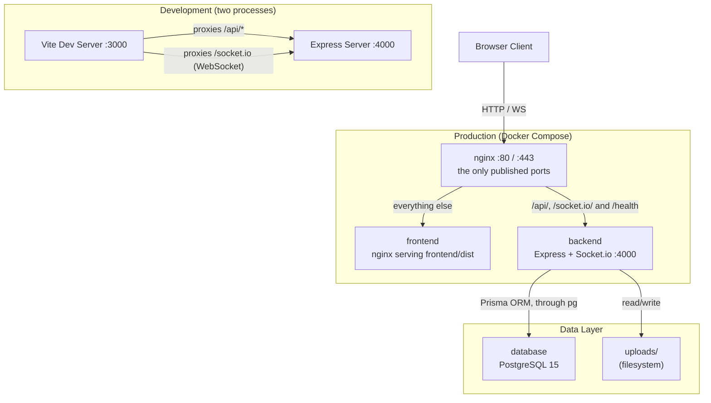
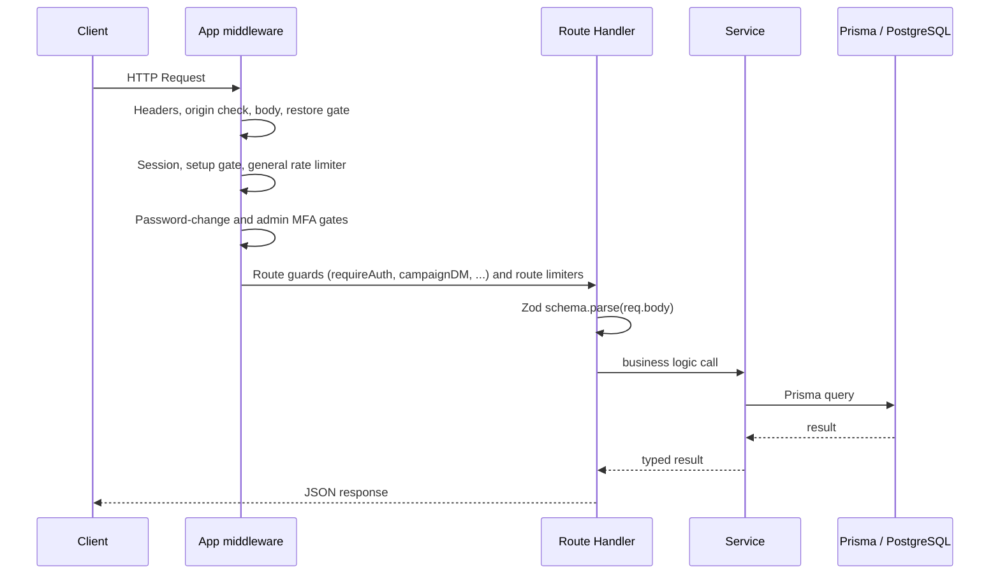
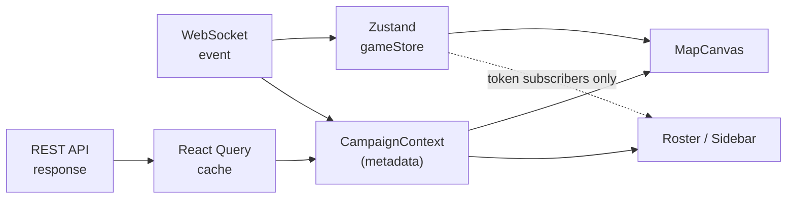
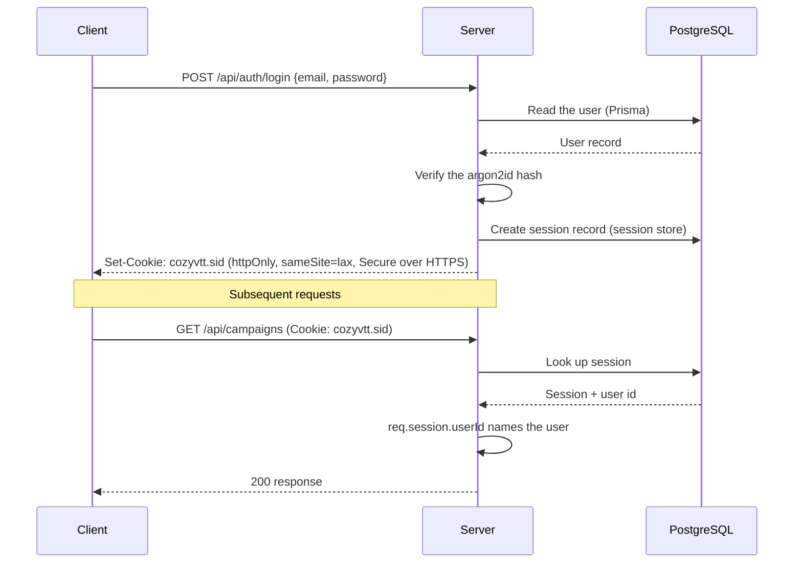
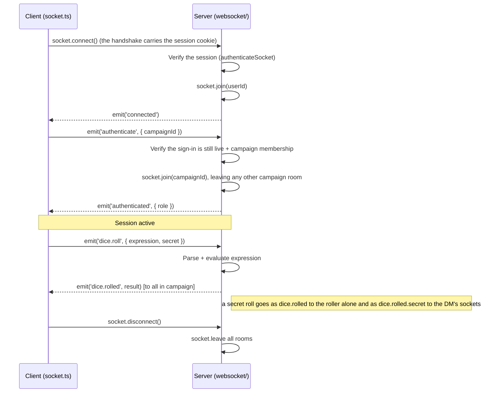

# CozyVTT — Architecture

This document describes the system architecture, data models, and key design decisions in CozyVTT.

---

## Table of Contents

1. [High-Level Overview](#high-level-overview)
2. [Backend Architecture](#backend-architecture)
3. [Frontend Architecture](#frontend-architecture)
4. [Database Schema](#database-schema)
5. [Authentication & Authorization](#authentication--authorization)
6. [WebSocket Architecture](#websocket-architecture)
7. [File Storage](#file-storage)
8. [Game Systems Architecture](#game-systems-architecture)
9. [Key Design Decisions](#key-design-decisions)

---

## High-Level Overview

CozyVTT is a monorepo containing a Node.js/Express API backend and a React SPA frontend. The backend serves the REST API, the Socket.io live connection and the uploaded files; it does not serve the built frontend. In production the Docker stack (`docker-compose.yml`) runs four containers on one internal network: `nginx` is the only one with published ports, it sends `/api/`, `/socket.io/` and `/health` to `backend` and everything else to `frontend`, which serves the built SPA, and `database` is PostgreSQL, which publishes no port and which only the backend connects to. Without Docker, a host nginx does the public `nginx` container's job and serves `frontend/dist` itself (the deployment guide's manual install). In development, a Vite dev server runs separately and proxies API/WebSocket traffic to the backend.



### The bundled nginx

The Docker production stack (`docker-compose.yml`) puts two nginx servers in front of the backend. The `nginx` service is the public entry: it sends `/api/`, `/socket.io/` and `/health` to the backend and everything else to the `frontend` container, whose own nginx serves the built SPA with the page's security headers (`frontend/nginx.conf`, `frontend/security-headers.conf`). The public one is made from the files in `nginx/`:

| File | What it does |
|---|---|
| `nginx.conf` | A template the image's entrypoint renders (only the variables in `NGINX_ENVSUBST_FILTER`): body size, compression, resolver, which addresses are believed about the visitor's address and protocol, the plain-HTTP server, and last `include /etc/nginx/cozyvtt.d/*.conf` |
| `locations.conf` | The proxying rules, included by the plain-HTTP server and by the HTTPS server a self-hoster writes from the deployment guide's example |
| `trusted-proxies.envsh` | Sourced by the entrypoint before it renders the template: turns `NGINX_TRUSTED_PROXIES` from `.env` into `set_real_ip_from` lines and the `geo` list that decides whether `X-Forwarded-Proto` is believed |
| `conf.d/` | The self-hoster's own files, HTTPS among them, mounted at `/etc/nginx/cozyvtt.d`; git ignores all but its README |
| `certs/` | Their certificates; git ignores them |

The first three are mounted one file each, and a single-file mount keeps the file it found when the container was made, so `NGINX_CONF_STAMP` on the service has to change with any of them; `backend/src/__tests__/keepInStep.test.ts` holds it to their hash.

### The containers

Every service in `docker-compose.yml` runs with `no-new-privileges`, drops every Linux capability (`cap_drop: ALL`) and gets back only those its start needs as root (`cap_add`):

| Service | `cap_add` | What uses them | Filesystem |
|---|---|---|---|
| `database` | `CHOWN`, `DAC_READ_SEARCH`, `SETUID`, `SETGID` | The image's start script, which gives the data folder to the postgres user, looks inside it and switches to that user; PostgreSQL runs with none | Writable; the data is on the `postgres_data` volume |
| `backend` | `CHOWN`, `DAC_READ_SEARCH`, `FOWNER`, `SETUID`, `SETGID` | `scripts/start.sh`, which gives the `uploads`, `logs` and `backups` folders to `appuser`, makes `backups` its alone (mode 700) and switches to `appuser` through `su-exec`; the backend runs with none | Read-only; it writes only to those three bind-mounted folders and to `/tmp`, the `backend_tmp` volume |
| `frontend` | `CHOWN`, `SETUID`, `SETGID`, `NET_BIND_SERVICE` | nginx's master process, which gives its scratch folders to the nginx user, listens on port 80 and starts its workers as that user | Read-only; `/run`, `/var/cache/nginx` and `/tmp` are held in memory (`tmpfs`) |
| `nginx` | As `frontend`, and `DAC_READ_SEARCH` | The same, on ports 80 and 443, and reading a file only its owner may read, such as a TLS key in `nginx/certs` | Read-only; `/run`, `/tmp` and `/etc/nginx/conf.d` (where the entrypoint renders `nginx.conf`) in memory, and `/var/cache/nginx`, where bodies too large to hold in memory wait, on the `nginx_temp` volume |

The two volumes keep large scratch files out of memory, where they would count against the container's memory limit (`BACKEND_MEMORY_LIMIT` for the backend, 512 MB when unset; 64 MB for nginx). Root in the backend container cannot write `appuser`'s files without first taking them over, so a command run there runs as `appuser` (`docker compose exec -u appuser backend ...`). Once `start.sh` runs as `appuser`, it removes any folder a stopped backup or restore left in `/tmp` (see File Storage), waits for the database, and applies the migrations with `./node_modules/.bin/prisma migrate deploy`, the project's own Prisma, since `npx` writes to the home folder, which is read-only. Then it starts `node dist/server.js`.

---

## Backend Architecture

### Layer Structure

```
src/
├── server.ts          Entry point: reads the .env in its working directory (backend/.env in
│                      development) first, through config/loadEnvFile.ts, then builds the
│                      app, attaches Socket.io, starts listening
├── app.ts             createApp: every middleware, gate, router and error handler, in
│                      order; the integration tests build their app with it too
├── config/            Configuration loading (env vars, validation); prismaClient.ts makes every
│                      Prisma client (see Database Schema), database.ts holds the app's shared one
├── middleware/
│   ├── auth.ts        Session-cookie authentication: requireAuth, requireAdmin, requireRole
│   ├── rbac.ts        Campaign roles: loadCampaignMembership, requireDM, requireDMOrPlayer
│   │                  and requireCampaignMember, read from the database for the route's
│   │                  :campaignId, never from the request body
│   ├── compose.ts     The guards routes actually use, composed: authenticated, adminOnly,
│   │                  campaignMember, campaignDM
│   ├── setup.ts       The setup gate: everything but /api/setup and /health is refused
│   │                  until setup has run; asks the database only until it hears it has
│   ├── passwordChange.ts  Gates every route until an admin-issued password is replaced
│   ├── adminMfa.ts        Gates an administrator without MFA past their deadline (services/adminMfaPolicy.ts);
│   │                      re-reads the admin's role on every request
│   ├── originCheck.ts     Refuses a change a browser sent from another site (HTTP and the socket handshake)
│   ├── restoreGate.ts     Refuses API requests while a backup restore replaces the database
│   ├── bodyParsers.ts     JSON body parsing and its 1 MB limit (a form-encoded body is not read), shared with the test app
│   ├── errorHandler.ts    The JSON error answer for anything a route did not catch
│   ├── failureLimiter.ts  The limiter on wrong passwords, codes and reset links: counts only
│   │                      wrong answers, per address (an IPv6 address by its /56 network)
│   │                      unless it is given another key, such as the account
│   ├── authLimiters.ts    The per-account sign-in limit and the signed-in password-check limit
│   ├── hashingPerAddress.ts  At most two requests that hash a password running at once from one address
│   ├── invitationEmailLimiter.ts  How many invitation emails a DM may have the instance send
│   ├── leftNotesDownloadLimiter.ts  How often a user may download all the notes of a campaign they have left
│   ├── campaignArchiveLimits.ts  Per-user hourly limits on previewing, importing
│   │                  and exporting campaign archives, one archive at a time, which the
│   │                  Universal VTT map export shares (the other HTTP limiters are
│   │                  declared beside their routes, and the general /api limiter in app.ts)
│   ├── downloadOnly.ts    Refuses an export the browser is loading as part of a page
│   │                  (Sec-Fetch-Dest), so a page cannot have the server build archives
│   ├── fileValidation.ts  Content check: an upload must be a type its asset kind allows
│   └── upload.ts      Multer configuration
├── routes/            HTTP route handlers
│   ├── auth.ts        Sign-in, sign-out, registration, password reset and change, MFA,
│   │                  account deletion
│   ├── users.ts       A user's profile and preferences (their own, or anyone's for an
│   │                  admin); the user list, deletion and reset actions are admin only
│   ├── campaigns.ts   Campaign CRUD + membership
│   ├── campaignMacros.ts Saved dice macros per campaign
│   ├── leftCampaigns.ts A removed member's own notes and macros, read only
│   ├── campaignDocuments.ts Documents shared with a campaign
│   ├── characters.ts  Character CRUD + assignment
│   ├── characterTemplates.ts Character templates every user can read and copy
│   ├── maps.ts        Map and token management
│   ├── creatures.ts   Creature template CRUD, SRD seeding, favorites
│   ├── tokenTemplates.ts A campaign's token templates (DM only), copied between campaigns
│   ├── assets.ts      File upload and retrieval
│   ├── invitations.ts Campaign invitation lifecycle
│   ├── setup.ts       First-run setup wizard; asks for the setup token (services/setupToken.ts)
│   │                  and runs services/setup.ts, one transaction for the first admin and the settings
│   ├── config.ts      Public client config (upload limits, whether the instance can send email)
│   ├── admin.ts       Admin: stats, health, settings, accounts, activity log, SMTP test,
│   │                  backups and restore
│   └── adminStorage.ts Admin: files in the uploads folder that no asset names
├── services/          Business logic (called by routes and WebSocket handlers)
├── validators/        Zod validation schemas (one per domain, incl. game-systems/)
├── websocket/
│   ├── index.ts       initializeWebSocket: the Socket.io server, the Express session
│   │                  shared with it, and the origin check at the handshake
│   ├── events.ts      Connection orchestrator: auth, disconnect, ping, and
│   │                  registration of every per-domain handler module
│   ├── shared.ts      Rate limiters and the per-user socket ceilings, the
│   │                  Token shape, fog helpers
│   ├── auth.ts        Socket session + campaign-membership authentication
│   ├── utils.ts       System-message / broadcast helpers
│   ├── signInSweep.ts Ends connections whose sign-in has ended, on a timer
│   ├── initiativeState.ts  Each campaign's combat order and round, kept in memory
│   ├── opId.ts        The id a page attaches to a wall or light edit, echoed back so it
│   │                  can tell its own edit from anyone else's
│   └── handlers/      One module per domain — tokens, dice, chat, spirit,
│                      vibe, maps, atmosphere, characters, initiative,
│                      walls, fog, lights, exploration, pings
├── utils/
│   ├── rules/            Game-system rules: dnd5e, pathfinder2e, callOfCthulhu7e, initiative and hitPoints,
│   │                  each byte-identical with the client's utils/rules/ (held by rules/__tests__)
│   ├── dice-parser.ts    Dice expression parser and roller (shared, byte-identical with the client)
│   ├── spirit-layer.ts   Spirit-layer + dynamic-lighting token filtering
│   ├── visibilityRule.ts What a viewer makes out of a point (shared, see Vision model)
│   ├── tokenCentre.ts    The point a token sees from and is seen at (shared)
│   ├── raycasting.ts     Line-of-sight polygons (shared, byte-identical with the client)
│   ├── spatialIndex.ts   Wall grid for large maps (shared)
│   ├── styleAllowlists.ts CSS-bound values the server accepts and the client re-checks (shared)
│   ├── asset-urls.ts     Asset URL normalization
│   ├── fileUtils.ts      Upload paths + MAX_*_SIZE_MB limit resolution
│   ├── sharpInput.ts     The only module that imports sharp: PNG, JPEG, WebP and GIF
│   │                     readers only (see Decoding pictures)
│   ├── thumbnails.ts     Map and token thumbnails, through sharpInput.ts
│   ├── totp.ts           Authenticator codes through otplib, each accepted once (see MFA)
│   ├── throttle.ts       Paces live drags: the first call at once, the last one after the
│   │                     wait, timed on a clock that cannot be set back
│   ├── serialQueue.ts    Work run one piece at a time across the server (the UVTT queue)
│   ├── keeperNotes.ts    Keeps a Call of Cthulhu sheet's Keeper's Notes to its campaign's DM
│   ├── proxyLimits.ts    Proxy body-cap parsing and startup warnings
│   ├── byteRange.ts      HTTP Range header reading for audio streaming
│   ├── shutdown.ts       SIGTERM/SIGINT: stop taking requests, let a dashboard backup or
│   │                     restore finish (up to 10 minutes, services/backupsInProgress.ts,
│   │                     services/restoreState.ts) and a deleted
│   │                     account's file removal (up to 4 seconds), close sockets,
│   │                     database and session store, then exit; an error nothing caught is
│   │                     logged before the process exits 1
│   └── logger.ts         Winston logger configuration
└── types/             Shared TypeScript interfaces
```

Real-time gameplay logic lives in the per-domain `websocket/handlers/*` modules; each exports a `registerXxxHandlers(io, socket)` called once per connection so per-connection state (throttles, rate-limit buckets) is preserved. `events.ts` is a thin orchestrator that wires them together.

### Request Flow

`createApp` (`app.ts`) mounts everything in the order a request meets it:

1. `trust proxy` set to one hop (the bundled nginx), so the limiters read the visitor's address and the cookie is marked Secure over HTTPS
2. helmet's headers, then CORS for `CORS_ORIGIN`
3. `originCheck`: a change a browser sent from another site is refused
4. `bodyParsers`: JSON up to 1 MB, and an empty body for a request that sent none
5. On `/api`, the restore gate (`restoreGate.ts`), ahead of the session lookup
6. The session (`express-session` over the PostgreSQL store)
7. The setup gate, which lets only `/health` and `/api/setup` through until setup has run
8. `GET /health`, answered here, with no rate limit
9. On `/api`, the general rate limiter (`RATE_LIMIT_MAX_REQUESTS` a minute per address, 300 by default; express-rate-limit counts an IPv6 address by its /56 network)
10. On `/api`, the password-change gate, then the administrator MFA gate
11. The routers: setup, config, auth, users, admin, campaigns (with macros and documents), characters, character templates, invitations, assets, and the maps, creatures and token templates nested under `/api/campaigns/:campaignId`
12. A JSON 404 for anything no router answered, then `errorHandler`: 413 for a body over the limit and 400 for one that is not valid JSON, and a JSON 500 for anything else a route throws or a promise it returns rejects with, Error or not; when the answer has already started, it logs the error and leaves Express to end the connection

Inside a router, each route names its own guards (`middleware/compose.ts`; the admin router mounts its two for every route) and any limiter of its own, then checks its body with Zod.



---

## Frontend Architecture

### Layer Structure

```
src/
├── main.tsx           Entry point: renders App inside AppRouter
├── AppRouter.tsx      The browser router, with React Router's transitions off
├── App.tsx            Route definitions, auth guards, lazy page loading
├── contexts/
│   ├── AuthContext.tsx    User auth state, login/logout/register actions
│   ├── WebSocketContext.tsx  Socket.io connection lifecycle and event subscriptions
│   ├── CampaignContext.tsx   Per-campaign metadata (campaign, current map, vibe, session status, roster)
│   ├── LayoutContext.tsx     Which arrangement the campaign page draws (useCompactLayout)
│   ├── ThemeContext.tsx      The theme and font in force, and the instance's default
│   ├── ThemeSyncBridge.tsx   Applies the signed-in user's saved theme over the default, and clears it at sign-out
│   └── ToastContext.tsx      The small notices the app shows
├── stores/
│   └── gameStore.ts   Zustand store for live socket-fed session state (token positions, combat/initiative, hit points, who is online, the current map's drawings), plus the page's own hover cross-highlight, selected token, open session tab and the chat's unread count
├── lib/
│   └── queryClient.ts  React Query client configuration
├── pages/             One file per route (thin; delegates to components, contexts, and query hooks)
├── components/
│   ├── ui/            Shared UI primitives (Button, Modal, SlideOver, FloatingLayer, Input, Field, Tooltip), and the shape of a menu's items (menu.ts)
│   ├── campaign/      Campaign page panels (ChatPanel, DiceRoller, SessionSidebar, MapCanvas, etc.), the page's desktop arrangement (DesktopTable) and the hosts that draw its parts once (tableHosts.tsx)
│   │   └── map/       MapCanvas render layers, coordinate conversions, fog and wall selection, vision cache, explored memory, preview selection, the held token (where it is drawn, the square a pointer carries it to, its release: tokenHold.ts), animation/render-loop hooks, the canvases' size and transform at the screen's pixel ratio (layerCanvas.ts), the one pointer shape the tools read (mapPointer.ts), the touch gesture recogniser (gestures.ts), the click a long-press's lift may bring (clickSwallow.ts), the token and door menus as data (tokenMenuItems.ts, doorMenuItems.ts), and the drawings on the page (useMapDrawings.ts, drawingPreviews.ts, drawingGeometry.ts, drawingHitTest.ts)
│   │       └── tools/ Each map tool's pointer and key handling: walls, lights, doors, fog boxes, the ruler and AoE template
│   ├── character-sheets/  Game system sheet renderers
│   ├── common/        Reusable primitives (ToastContainer, ConfirmDialog, EmptyState, etc.)
│   └── admin/         Parts of the Admin Panel (activity details, deletion blockers, the
│                      leftover files panel); the tabs themselves are in pages/AdminPage.tsx
├── services/
│   ├── api.ts         Axios-based REST API client (singleton)
│   ├── socket.ts      Socket.io client wrapper (singleton)
│   ├── unsavedWork.ts What a lost session does while an editor has unsaved changes
│   ├── pageLoad.ts    The full page loads the API client sends a page on with (sign in, required pages)
│   ├── signInNotice.ts  The reason a sign-in ended, carried to the sign-in page across that load
│   ├── sessionKeepAlive.ts  Pings the session from the game table and from editors with unsaved changes
│   └── auth.service.ts  Auth-specific API calls
├── hooks/
│   └── queries/       React Query hooks wrapping the REST services (useCampaignsQuery, useCharactersQuery, useAssetsQuery, …)
├── types/             TypeScript type definitions mirroring backend types
├── utils/             Client-side helpers (validation, formatting); utils/rules/ mirrors the
│                      backend's game-system rules files byte for byte
├── assets/fonts/      The bundled typefaces: fonts.css, one @font-face per family and
│                      character range (and weight, where a family has no variable
│                      font), and their OFL.txt
├── index.css          Tailwind, its @theme keys, the theme variables and the shared classes
└── styles/            The atmosphere and spirit-layer effect stylesheets, and the Markdown
                       styles of notes and the document reader
```

### Router and build

`AppRouter.tsx` runs the app in React Router's `BrowserRouter` with `useTransitions={false}`. From React Router 7 on, each move between pages is wrapped in a React transition unless told otherwise, and code that changes state and then navigates, such as signing out and then opening the sign-in page, rendered once more at the old address with the new state. With transitions off the new page renders at once, and a page still loading shows the spinner.

The production build (`npm run build`, which is `vite build`) bundles with Rolldown, Vite 8's bundler, configured under `build.rolldownOptions` in `vite.config.ts`:

- `console.log`, `info`, `debug` and `trace` calls are declared pure (`treeshake.manualPureFunctions`), so the bundle leaves them out: they print chat messages, secret rolls and token details. `console.error` and `console.warn` stay. The dev server bundles nothing, so development keeps every log. A CI step fails the frontend job when a line only such a call prints is found in the bundle.
- React with React Router, framer-motion, socket.io-client, lucide-react and react-markdown each go into a named vendor chunk (`codeSplitting.groups`), which a browser keeps cached while the app's own code changes.
- No `build.target` is set, so the scripts are written for Vite's default, `baseline-widely-available`: Chrome and Edge 111, Firefox 114, and Safari 16.4 on macOS and iOS. The stylesheet asks more of Firefox: Tailwind CSS 4 is built for Firefox 128 (and the same Chrome, Edge and Safari), so that is the floor the guides give.
- Tailwind CSS 4 runs as a Vite plugin (`@tailwindcss/vite`), with no PostCSS or Tailwind config file: its settings are the `@theme` block and the `@utility` rules in `src/index.css`. That block keeps Tailwind 3's line heights in rem, and `src/styles/tailwind3-palette.css` keeps Tailwind 3's palette, so the move changed no color; gradients take the `/srgb` modifier to blend as Tailwind 3's did.

### State Management

CozyVTT uses three complementary state layers, each with a clear boundary. The rule of thumb: **React Query owns server resources, Zustand owns live socket-fed session state, and React Context owns app/session wiring — never two layers for the same datum.**

| Layer | Owns | Examples |
|-------|------|----------|
| **React Query** (`@tanstack/react-query`) | Server resources fetched over REST | Campaign lists/detail, characters, assets, map metadata |
| **Zustand** (`stores/gameStore.ts`) | Live, high-frequency state fed by WebSocket events | Token positions and list, combat/initiative, characters' hit points, who is online (`presence.state`, for the roster and the chat's To list); and two things of the page's own, fed by no socket: the hover cross-highlight, which the map and the tracker share, and the selected token (`selectedTokenId`, kept across a new token list while the list holds it, cleared when the map changes). The session rail's open tab (`sessionTab`, remembered in the browser under `cozyvtt-session-tab`) and the Chat tab's unread count (`unreadChat`) are here too, so the tab bar and the panels read one value wherever the page draws them; `clearGameState` empties the count as a page opens a campaign or leaves it. Nothing else of the table's own state is lifted into the store: the map, the session panels and the Party content are drawn once for the page (see [The campaign page's arrangements](#the-campaign-pages-arrangements)), so what they hold stays in them. The current map's drawings are here too (`drawings`, replaced whole on a map switch); the previews of strokes on their way are not, since they change every frame, and live in a ref the overlay reads. Walls, fog and lights are still MapCanvas-local; walls additionally keep their own undo/redo history |
| **React Context** | App/session wiring and metadata | Auth state, socket connection, campaign metadata + vibe/session status |

A page that changes a server resource away from the page that lists it updates that list's cache itself. The characters list, for instance, is served from cache for 30 seconds, so the full-page character editor and the templates page write what they saved or created into it with `storeCharacterInList` (`hooks/queries`); otherwise the Characters page would show a new character late, or an old name. The characters list and the character template list hold no sheets (the server lists them without `data`), so a page that opens, exports, copies or edits one fetches it by id first.

The split exists for performance. Live token movement is written to the Zustand store from **outside** React, so a `token.moved` event re-renders only the components subscribed to that token (the map canvas) — the roster, initiative tracker, and side panels don't re-render per movement frame. Characters' hit points live there for the same reason: a hit in a fight redraws the roster and the map's health bars only. All three context provider values are memoized so unrelated socket traffic doesn't cascade re-renders through the campaign subtree. After a settings or roster change the campaign is re-read in place (`refreshCampaign`); only the first load shows the page's loading screen.

### Theming

Every color in the themed UI comes from a CSS variable, so switching themes repaints the app without
re-rendering anything. `applyThemeColors` ([themes.ts](../frontend/src/themes.ts)) sets each token's
channels on the page as `--rgb-x`, such as `--rgb-brand: 74 93 78`, and the `@theme` block in
[index.css](../frontend/src/index.css) gives Tailwind each one as `--color-x: rgb(var(--rgb-x))`, which is
why opacity modifiers such as `bg-danger/10` still follow the theme. The two prefixes stay apart on
purpose: a page variable named like a Tailwind key would replace that key, and Tailwind would then
read bare channels as a color and paint nothing.

| Group | Tokens | Use for |
|---|---|---|
| Brand / accent | `brand`, `brand-dark`, `accent`, `accent-hover`, `accent-text` | Fills: buttons, borders, highlights |
| Text | `ink`, `ink-secondary`, `ink-muted` | Body, secondary and muted text |
| Surfaces | `canvas`, `surface`, `surface-light`, `surface-dark`, `paper` | Page and panel backgrounds |
| **Ink variants** | `brand-ink`, `accent-ink`, `spirit-ink`, `danger-ink`, `success-ink`, `warning-ink`, `info-ink` | **Text** in that color |
| States | `danger`, `success`, `warning`, `info`, `spirit` | Status fills, borders, tints |

**Three rules keep themes readable:**

1. **Use `-ink` when the color is text.** `accent` is a fill — as text it measured as low as 1.84:1.
   The `-ink` variants are derived per theme by `deriveReadableTokens`
   ([themes.ts](../frontend/src/themes.ts)) via `ensureReadable`
   ([utils/color.ts](../frontend/src/utils/color.ts)), which walks the color's lightness until it
   clears WCAG AA against that theme's surfaces, and against its own tint (a chip or alert at 15%).
   `ink-secondary` and `ink-muted` are derived the same way against a 10% wash of the ink, which
   inset panels and hovered rows use. Authored values that already pass are left alone.
   Custom themes get the same treatment, so a user-picked palette cannot produce unreadable text.
   The first-paint defaults in index.css's `:root` are the default theme's derived values, and
   `themeVariables.test.ts` holds them to it.
2. **Tell the browser a dark theme is dark.** `applyThemeColors` sets `color-scheme` from the
   paper's lightness, so native text boxes, checkboxes and dropdown lists follow the theme.
3. **Never use a raw Tailwind palette color on a themed surface.** `bg-red-50` stays pale pink on a
   dark theme. Use the state tokens, or the `.alert-*` / `.badge-*` classes in
   [index.css](../frontend/src/index.css).

The second rule is enforced by a test: `utils/__tests__/themeTokens.test.ts` fails if raw palette
colors appear outside the two exempt areas (character sheets, which are deliberately styled as light
"paper" cards, and the dark tool panels over the map, the DM's and the drawing tools). The first is not. `utils/__tests__/themes.contrast.test.ts`
checks that every preset theme's text tokens, the `-ink` ones included, meet AA on the backgrounds
they are used on, but nothing fails when text uses a plain fill token such as `text-danger`, so
review has to catch that.

### Data Flow (Campaign Page)



### The campaign page's arrangements

The campaign page (`pages/CampaignPage.tsx`) arranges the same parts in one of two ways, and exactly one arrangement is mounted at a time: the desktop's header and three resizable columns, `components/campaign/DesktopTable.tsx`, and a compact arrangement for narrow screens, which is not drawn yet. `contexts/LayoutContext.tsx` says which. The page's `LayoutProvider` gives `compact`, fixed at false for now, so every screen gets the desktop arrangement, with the Desktop Required notice over it below 1024 px; a component that changes with the arrangement asks `useCompactLayout()`, which is false outside the provider, as on every other page. The width is `COMPACT_LAYOUT_QUERY` (`constants/layout.ts`), written once; the Creature Library and Token Templates ask it themselves.

The parts that hold the table's state are drawn once for the page and moved between arrangements, so a change of arrangement, such as a tablet turned across that width, remounts none of them:

| Part | What a remount would lose |
|---|---|
| The map (`MapCanvas`) | A held token, a stroke or wall line in progress, wall undo, Player Preview and the view; and every request for the map's state would be sent again, which the server answers at most five times a second |
| The session panels (`SessionPanels`) | The chat's whisper recipient and unsent messages, what the dice panel was set to roll, the open note; the chat and dice history read again |
| The Party content (`CampaignInfo`, `CampaignRoster` and, for the DM, `TokenRoster`) | The roster's listeners; it also seeds the hit points the map's bars read |

`components/campaign/tableHosts.tsx` does the moving. `TableHosts` renders each part through a portal into a host element of its own, made once and styled `display: contents`, so it adds no box. An arrangement marks the element each part fills with `useTableSlot(part)`; the host is moved into that slot as the slot mounts, and into a parking box (laid out, clipped to nothing) as it unmounts, to wait for the next arrangement's slot. The portal's container never changes, so React never remounts the part, and a part is first drawn once its host is in a slot, so it is measured in place. A move keeps the keyboard focus (the browser's `moveBefore` keeps it where the browser has one; elsewhere the same element is focused again after the move), and a `ResizeObserver` goes on observing its element and reports the new size. React events from a part bubble through `TableHosts`, not through the slot, so a slot takes no React handlers meant for what is in it; DOM listeners, the panel library's among them, see the part where it is drawn. A slot with no `TableHosts` above it says so (`hosted: false`), and its component draws the part itself, as the session rail does when a test draws it alone.

What else an arrangement change must keep stays above both arrangements, in the page: its socket listeners, every window and slide-over and whether it is open, and the token quick editor. The open session tab and the Chat tab's unread count are in the game store, since an arrangement's tab bar sets and shows them. Nothing else of the parts' state is lifted: they are never remounted, so the chat's draft, the map's zoom and pan and the rest stay in the components that hold them.

---

## Database Schema

The full Prisma schema is at `backend/prisma/schema.prisma`, and the Prisma command-line tools (`generate`, `migrate deploy`, `db push`) take their settings from `backend/prisma.config.ts`. `prisma generate` writes the client (the `prisma-client-js` generator) into `node_modules/.prisma`: `npm run build` runs it before compiling, and the production image copies what it wrote. Since Prisma 7 the client has no connection engine of its own: it runs its queries through the `pg` driver, the one the session store uses through a pool of its own, by way of `@prisma/adapter-pg`. `backend/src/config/prismaClient.ts` makes every client the backend, its scripts and its tests use, and reads a `DATABASE_URL` written for Prisma into pg's terms: `?schema=` names the schema queries are qualified with and becomes the connection's `search_path` (raw queries name their tables unqualified), `?connection_limit=` becomes the pool size (pg's default otherwise, ten), and a new connection may take five seconds. Below is an entity relationship diagram of every model, with the fields that matter here. A test checks it against the schema, so a model, field or relation that does not exist cannot stay in it. The login sessions are `LoginSession`, the `session` table that `connect-pg-simple`, and `services/sessionStore.ts` with raw queries, read and write themselves (see Authentication below). It is in the schema so the migrations make it and `prisma db push` keeps it, and `@@ignore` leaves it out of the Prisma client. The `Session` below is a game session.

```mermaid
erDiagram
    User {
        string id PK
        string email
        string displayName
        PlatformRole platformRole
        bool globalAssetManager
        bool templateEditor
        bool isApproved
        bool mfaEnabled
        bool mustChangePassword
        string avatarUrl
        string bio
    }

    PasswordResetToken {
        string id PK
        string userId FK
        datetime expiresAt
        bool used
    }

    Campaign {
        string id PK
        string name
        string description
        GameSystem gameSystem
        CampaignStatus status
        string ownerId FK
        string currentMapId FK
        json vibeSettings
        string spiritLayerStyle
        bool spiritLayerEnabled
        bool chatCooldownEnabled
        bool playersMayDraw
    }

    CampaignMembership {
        string id PK
        string userId FK
        string campaignId FK
        CampaignRole role
        string[] characterIds
    }

    CampaignInvitation {
        string id PK
        string campaignId FK
        string userId FK
        InvitationStatus status
        datetime expiresAt
    }

    Character {
        string id PK
        string userId FK
        string campaignId FK
        string name
        GameSystem gameSystem
        json data
        string tokenImageUrl
    }

    CharacterTemplate {
        string id PK
        string name
        string description
        GameSystem gameSystem
        json data
        string tokenImageUrl
        string createdById FK
    }

    Map {
        string id PK
        string campaignId FK
        string name
        string imageUrl
        int width
        int height
        int gridSize
        json tokens
        json wallSegments
        json lights
        json fogData
        bool lightingEnabled
        bool fogEnabled
        bool explorationEnabled
    }

    MapExploration {
        string id PK
        string mapId FK
        string userId FK
        json explored
    }

    MapDrawing {
        string id PK
        string mapId FK
        string authorId FK
        DrawingAudience audience
        DrawingLayer layer
        string kind
        string color
        string fillColor
        int width
        json points
        string text
    }

    Asset {
        string id PK
        AssetType type
        AssetScope scope
        string uploadedById FK
        string campaignId FK
        string filename
        string originalName
        int fileSize
        string mimeType
        string thumbnailPath
        string[] tags
    }

    Message {
        string id PK
        string campaignId FK
        string userId FK
        string recipientId FK
        MessageType type
        string content
        json metadata
    }

    DiceRoll {
        string id PK
        string campaignId FK
        string userId FK
        string expression
        int result
        bool secret
    }

    Session {
        string id PK
        string campaignId FK
        int sessionNumber
        datetime startedAt
        datetime endedAt
        json savedState
        string notes
    }

    PersonalNote {
        string id PK
        string userId FK
        string campaignId FK
        string title
        string content
        datetime updatedAt
    }

    DiceMacro {
        string id PK
        string userId FK
        string campaignId FK
        string name
        string expression
        datetime createdAt
    }

    CreatureTemplate {
        string id PK
        string name
        GameSystem gameSystem
        string source
        string challengeRating
        string creatureType
        json statBlock
        json size
        string disposition
        string displayMode
        string imageUrl
        string createdById FK
        string campaignId FK
    }

    CreatureFavorite {
        string id PK
        string campaignId FK
        string userId FK
        string creatureId FK
        datetime createdAt
    }

    TokenTemplate {
        string id PK
        string campaignId FK
        string createdById FK
        string name
        string type
        json size
        json statBlock
    }

    CampaignDocument {
        string id PK
        string campaignId FK
        string assetId FK
        string linkedById FK
        datetime createdAt
    }

    SystemSettings {
        string id PK
        bool setupCompleted
        string instanceName
        bool allowRegistration
        bool requireAdminApproval
        string themeId
        string fontId
    }

    SystemLog {
        string id PK
        LogLevel level
        string message
        json context
        datetime createdAt
    }

    LoginSession {
        string sid PK
        json sess
        datetime expire
    }

    User ||--o{ Campaign : "owns"
    User ||--o{ CampaignMembership : "belongs to"
    Campaign ||--o{ CampaignMembership : "has"
    User ||--o{ CampaignInvitation : "is invited"
    Campaign ||--o{ CampaignInvitation : "has"
    User ||--o{ PasswordResetToken : "has"
    User ||--o{ Character : "owns"
    User ||--o{ CharacterTemplate : "published"
    Campaign ||--o{ Character : "has assigned"
    Campaign ||--o{ Map : "has"
    Map ||--o{ Campaign : "is shown by"
    Map ||--o{ MapExploration : "remembered in"
    User ||--o{ MapExploration : "explores"
    Map ||--o{ MapDrawing : "is drawn on in"
    User ||--o{ MapDrawing : "draws"
    Campaign ||--o{ Message : "has"
    User ||--o{ Message : "writes"
    User ||--o{ Message : "receives whispers"
    Campaign ||--o{ DiceRoll : "has"
    User ||--o{ DiceRoll : "rolls"
    Campaign ||--o{ Session : "has"
    Campaign ||--o{ PersonalNote : "has"
    User ||--o{ PersonalNote : "writes"
    Campaign ||--o{ DiceMacro : "has"
    User ||--o{ DiceMacro : "saves"
    User ||--o{ Asset : "uploaded"
    Campaign ||--o{ Asset : "scoped to"
    Campaign ||--o{ CreatureTemplate : "scoped to"
    User ||--o{ CreatureTemplate : "made"
    CreatureTemplate ||--o{ CreatureFavorite : "favorited as"
    User ||--o{ CreatureFavorite : "has favorites"
    Campaign ||--o{ CreatureFavorite : "scoped to"
    User ||--o{ TokenTemplate : "made"
    Campaign ||--o{ TokenTemplate : "has"
    Campaign ||--o{ CampaignDocument : "shares"
    Asset ||--o{ CampaignDocument : "shared as"
    User ||--o{ CampaignDocument : "linked by"
```



### Key Schema Notes

- **Token data is stored as JSON inside `Map.tokens`** — tokens are not a separate table. This simplifies real-time updates (the whole token list is atomically replaced on moves).
- **Walls, lights and fog are JSON on the map row too** (`Map.wallSegments`, `Map.lights`, `Map.fogData`). A write to any of these columns, or to `Map.tokens`, reads the whole value, changes it and writes it back, so it runs inside `withMapsLocked` (`utils/mapTokens.ts`): a transaction holding a PostgreSQL advisory lock on the map, which reads the value through the transaction after taking the lock. Edits sent together, from the socket or the REST routes, then apply one after another instead of the later write dropping the earlier change. Writers to the same map in the backend wait their turn in the process before opening the transaction, so only one of them holds a pooled connection at a time; the advisory lock still covers any other process on the same database. Every other edit of the map waits while the lock is held, so slow work belongs before it is taken, and so does any read through the global `prisma` client, which would hold a second connection while the transaction holds one. A player's door toggle, for instance, works out their line of sight first (`doorSightFor` in `websocket/handlers/walls.ts`), then judges the door as it reads it under the lock.
- **Character sheet data is stored as JSON in `Character.data`** — the schema is validated at the API layer by game-system-specific Zod schemas (a Flexible sheet, with no game system, by `flexible.schema.ts`) but stored untyped in Postgres. This allows flexible incremental saves. Every text field a sheet stores has a length limit, from `validators/game-systems/sheetLimits.ts`, which the frontend keeps an identical copy of for its editors. Counts are limited where a list could grow without bound in play: Flexible sections, stats, list entries, table rows, columns and cells; D&D 5e spell slots (0 to 20 a level); the D&D 5e manual bonuses (-30 to +30); every list on a D&D 5e, Pathfinder 2e, Call of Cthulhu or Shadowrun 6e sheet (500 entries, `SHEET_LIST_MAX`, through `sheetList` in `sheetLists.ts`; the editors turn an add button off at the limit), with lower limits for a D&D 5e sheet's own skills (30) and one attack's further damage lines (10); and Pathfinder 2e spell slots (0 to 20 a rank, no more used than the total) and item bonuses (-30 to +30).
- **A Call of Cthulhu sheet's Keeper's Notes are its campaign DM's alone.** They are the sheet's top-level `notes`, kept inside `Character.data`, so the schema, exports and imports are unchanged. `utils/keeperNotes.ts` holds the rule: every route and event that sends a sheet passes it through `characterForReader`, which leaves the field out for anyone but the DM of the character's campaign; a save by anyone else keeps the stored notes (`sheetKeepingKeeperNotes`); and a character that enters another campaign has them cleared, since they were the last campaign's Keeper's.
- **`vibeSettings` and `Session.savedState` are JSON columns** — used to persist complex nested state that changes frequently.
- **`CreatureTemplate` uses two scopes** — SRD creatures have `campaignId = null` (global, read-only) while custom creatures have a campaign FK. The `source` field distinguishes them (`'srd'` vs `'custom'`).
- **`DiceMacro` is private to whoever saved it**, on the same terms as `PersonalNote` and enforced the same way. Its `expression` is validated when written by rolling it and discarding the result, so a stored macro is always one the roller accepts — ordered by `createdAt` rather than `updatedAt` because these are buttons, and editing one must not move it.
- **`PersonalNote` is private to its author** — every query is scoped by both `campaignId` and the signed-in `userId`, and a note belonging to someone else answers 404 rather than 403 so the response cannot confirm that it exists. Nobody reads these but the person who wrote them, the DM included. Removing a member keeps both kinds of row; `GET /api/campaigns/left`, `/left/:campaignId`, `/left/:campaignId/notes` and `/left/:campaignId/notes/:noteId` let the author read their own afterwards, only while they are not a member, and deleting the campaign deletes them. The lists carry titles only. A note's text comes from `/notes/:noteId` one note at a time, or from `/left/:campaignId/notes` for all of a campaign's notes in one answer, which the Download button uses: it is written out ten notes at a time, since a campaign can hold 200 notes of 100,000 characters, and limited to 60 requests an hour per user.
- **`CreatureFavorite` is a per-campaign, per-user join table** — with a unique constraint on `(campaignId, userId, creatureId)` to prevent duplicate favorites. Cascade deletes ensure cleanup when creatures, users, or campaigns are removed.
- **`CampaignDocument` shares a document with a campaign without copying it.** A document is an ordinary `Asset` of type `DOCUMENT`; the join row, unique on `(campaignId, assetId)`, is what lets a `USER`-scoped rulebook be read by the members of every campaign it is linked to. It is the one place the asset read rule looks beyond scope: `canReadAsset` is the single function both the serving route and the linking route consult, so a DM cannot link a file they could not read themselves; and linking further requires the document to be the DM's own or `GLOBAL`, so a share into one campaign cannot be forwarded by a member of it who runs another. A DM who is a platform admin can read every document, so passes the first check, and is held to the second like anyone else: an admin links only their own documents and global ones, the rule a track for atmosphere audio follows. Unlinking revokes access; deleting the asset removes its links, and deleting the campaign leaves the document intact.

---

## Authentication & Authorization

### Session Authentication

CozyVTT uses **express-session** with **connect-pg-simple** to store sessions in PostgreSQL, through a `pg` pool of its own (`sessionPool` in `config/session.ts`), apart from the Prisma client's. The pool is built from the same reading of `DATABASE_URL` (`databaseConnectionSettings` in `config/prismaClient.ts`), so its size follows `?connection_limit=`, and the store names the schema `?schema=` gives: the sign-ins sit beside the tables, where `services/sessionStore.ts` ends them. This means sessions survive server restarts and scale to multiple processes.

Every password hash and check goes through `hashPassword` and `verifyPassword` (`services/auth.ts`), which run at most `HASH_SLOTS` (2) at once: Argon2id takes 64 MB a hash and a libuv thread, which file reads share. At most `HASH_QUEUE_MAX` (50) wait, each for at most `HASH_WAIT_MS` (10 seconds, inside the sign-in limiters' 15-second wait); past either the call throws `ServerBusyError`, which each route that hashes answers with 503 through `answeredBusy`, never counting it as a wrong password. The line is first come first served and a correct password is never counted, so one address could keep it full by itself: every route that hashes runs `hashingPerAddress` (`middleware/hashingPerAddress.ts`) first, which lets one address have `HASHING_PER_ADDRESS` (2) such requests running at once, keyed as the limiters key addresses, and answers a third 429 without counting it. Backup codes are hashed one after another, so a request takes one place in the line at a time, and a backup code is checked against all of an account's stored codes in one turn (`firstMatchingHash`), so a busy server refuses the check before it starts and never partway, with some codes compared and no wrong code counted. A sign-in for an email with no account is checked against a dummy hash, so it takes as long as a wrong password; `server.ts` has it made as the server starts (`makeDummyPasswordHash`, outside the line), so that sign-in takes one turn as a known email's does, and the first such sign-in makes it if that failed.



A session expires after an hour with no requests (`SESSION_MAX_AGE`; "Remember me" makes it 30 days), and each request starts the hour again. It also ends `REMEMBER_ME_MAX_AGE` (30 days) after it was made, however active: `signedInAt` is set at sign-in and checked by the guards, `GET /api/auth/me` (which shares the guards' check, `withinSignInLimitOr401`) and the socket handshake (`services/signedIn.ts`), and a session from before the field existed is stamped when next seen. A guard that refuses an aged-out sign-in also ends that sign-in's live connections. Each socket caches `signedInAt` at the handshake, and `websocket/signInSweep.ts`, started with the Socket.io server and stopped when it closes, ends every minute each socket past the limit, and every fifth minute also reads each socket's session from the store (`socketSignIn` in `websocket/auth.ts`) and ends those whose sign-in is gone, each with `campaign.access.revoked` and a disconnect. A session the store cannot read is left connected, logged once a sweep; joining a campaign treats it as ended. Each sign-in removes the account's oldest sessions beyond 20 (`capLoginSessions`), and the session row holds the user id and role, `signedInAt`, `mustChangePassword` and the MFA pending fields. Two kinds of activity make no requests, so they ping `GET /api/auth/ping` every ten minutes through `services/sessionKeepAlive.ts`: the campaign page while its live connection is up, and a character sheet editor while it holds unsaved changes (at once when the changes appear too, since the hour may be nearly up). When a request answers 401 on a page that needs a session, the API client's interceptor normally sends the browser to the sign-in page, carrying the page as `?next=` so signing in returns to it (`utils/returnTo.ts` follows only a path on this origin that is not a public page). While a character sheet editor holds unsaved changes it does not: `services/unsavedWork.ts` keeps the page where it is and marks the browser signed out, and the editor says so, with a link to sign in in a new tab. The session cookie is shared between tabs, so the editor's Save works once that sign-in is done. A sign-in that reached its age limit answers with `code: 'SIGN_IN_EXPIRED'`, and its sentence is kept in `sessionStorage` (`services/signInNotice.ts`) for the sign-in page to show once. The calls that check the current password or a code while signed in (change password, delete account, MFA disable, backup codes, MFA setup, an email change) answer 401 for a wrong one; they pass `skipAuthRedirect`, and their forms show the message. The sign-in check at page load treats only a refusal (a 4xx other than 408 and 429) as signed out; no answer or a server error shows "Can't reach the server" on protected pages and retries. A sign-in that succeeds meanwhile cancels the retry and clears the notice, and the answer to a check still on its way is dropped (`authEpoch` in `contexts/AuthContext.tsx`).

### Role-Based Authorization

Authorization is enforced at two levels, both by middleware named in the route declaration or mounted on its router:

1. **Platform level** — `requireAdmin`, after `requireAuth`, which checks the role stored in the session. The admin routers mount the pair ahead of every route they hold (`router.use` in `routes/admin.ts`, and on `/orphaned-files` in `routes/adminStorage.ts`); the admin routes of `routes/users.ts` name both, and `GET /api/campaigns/admin/all` uses `adminOnly`, the same pair from `middleware/compose.ts`
2. **Campaign level** — the guards composed in `middleware/compose.ts` (`campaignMember`, `campaignDM`). `loadCampaignMembership` reads the caller's `CampaignMembership` from the database for the `:campaignId` in the route's path, directly or through a router mounted with `mergeParams`, and never for a campaign id in the body; `requireDM` or `requireCampaignMember` then judges its role. The role comes from that row, never from the request

```typescript
// Example: a DM-only route. campaignDM is [requireAuth, loadCampaignMembership, requireDM];
// a non-member gets 403 "You are not a member of this campaign", a player or
// spectator 403 "This action requires Dungeon Master (DM) role".
router.put('/:campaignId', campaignDM, async (req: AuthenticatedRequest, res: Response) => {
  // req.campaignMembership is set and has role DM
});
```

### Ownership is a separate axis from the DM role

`Campaign.ownerId` and `CampaignMembership.role === 'DM'` are different facts.
They name the same person in a campaign whose creator still runs it, which is
most of them — and that coincidence is why five call sites independently worked
out "the DM" by looking up the owner, and only diverged once the DM seat became
movable (`PUT /api/campaigns/:id/dm`).

Decide **"is this user the DM?"** from the membership, never from `ownerId`.
Ownership decides three things: only the owner (or an admin) may delete the
campaign, so that the destructive power stays with whoever created it; the
owner may always hand the DM seat on; and the owner cannot be removed from the
campaign, so a handover can never lock an owner out. Ownership moves only when
the owner's account is deleted, to the sitting DM. The frontend asks
`src/utils/campaignRoles.ts`, which exists so the answer has one home rather
than five.

### Roles are a snapshot on an open socket

`socket.role` is read once, when the socket authenticates to a campaign, and
trusted by every gated handler thereafter — the right place to read it from,
since a handler must never take a role off the wire, but it means the value
goes stale if the role changes underneath it. A DM transfer therefore updates
connected sockets in place (`applyRoleToLiveSockets`) and broadcasts
`campaign.dm.transferred`, rather than waiting for a reconnect. REST needs no
equivalent: `loadCampaignMembership` reads the membership per request.
`authenticate` takes the new campaign's room and role with nothing awaited
after its membership read, so a change made while it tells the old campaign
finds the socket in the new room, and it reads the membership once more and
applies what it finds (`settleMembership` in `websocket/events.ts`) before it
sends `authenticated`, so a state request the client makes on hearing it is
answered with the settled role.

Taking access away works the same way. Removing a member and deleting a
campaign make the affected sockets leave the room and forget the campaign
(`clearCampaignFromLiveSockets`, `clearDeletedCampaignFromLiveSockets`), and
ending a sign-in closes its sockets (`endLiveSockets`; a restore ends every
socket with `endEveryLiveSocket`). Each socket is first sent
`campaign.access.revoked` with the reason (`removed`, `campaign-deleted`,
`signed-out`). On the client, `socket.ts` stops reconnecting after it, the
connection badge shows the reason, and `hooks/useAccessRevoked.ts` on the
campaign page goes to the dashboard with a notice, or to the sign-in page,
unless an editor holds unsaved changes.

### MFA (TOTP)

MFA uses the `otplib` library for TOTP secrets, setup links and verification. A new secret is 20 random bytes written in base32; the secrets stored before 1.5.2, made by an earlier library as 20 printable characters in base32, are read the same way. A code must be exactly six digits, and anything else is refused before it is checked. One 30-second step either side of the current one is accepted, for clock drift. Every check goes through `utils/totp.ts`, which accepts each code once: it remembers the last 30-second step accepted for each account and refuses a code from that step or an earlier one, at sign-in, when MFA is turned on and when it is turned off. That record is kept in the backend process's memory, which is sound for the single production process; a restart forgets it, and more than one backend process would need it moved to the database. The sign-in code step is rate limited per address (an IPv6 address by its /56 network) and, separately, per account. Backup codes are hashed with Argon2id, like passwords, and shown to the user only once. A code that matches is removed with one conditional `UPDATE ... array_remove` that only succeeds while that hash is still stored, so two sign-ins racing on a code cannot both use it and cannot write back a list that brings another code back.

### Administrators must use MFA

An administrator cannot turn MFA off (`POST /api/auth/mfa/disable` answers 403), and one without it has seven days to set it up (`ADMIN_MFA_GRACE_MS` in `services/adminMfaPolicy.ts`). The seven days run from the latest of five moments: when the rule started on this instance, when the account was created, when it was made an administrator, when another administrator last reset its MFA, and when an invitation link set its password. All but the account's creation are read from the activity log, so the rule needs no column. The first time the rule is needed, a line is written there, and the earliest such line is its start, which gives an upgraded instance's administrators a full week. A promotion and a Reset MFA are logged with a mark that starts the account's week again, and so is an invitation link setting the password (`POST /api/auth/reset-password` with a link that lasts longer than a reset link, for an administrator with no `lastLoginAt`), since the invitation itself lasts a week.

Until the deadline, the signed-in user the server returns carries `adminMfaDeadline`, which the pages show as a banner. After it, `middleware/adminMfa.ts`, mounted on `/api` after the password-change gate, answers every request 403 with `code: 'MFA_ENROLMENT_REQUIRED'`, except MFA setup and its verification, change password, sign-out, `/auth/me`, `/auth/ping`, `/auth/appearance` and `/config`; the API client then sends the browser to the MFA setup page. The gate reads the account once on each request a signed-in administrator makes, and ordinary users are not read. That read also refreshes the role the session holds: an administrator demoted while signed in loses the admin guards on their next request, and a session whose account is gone ends there. A database error lets the request through, so a passing fault cannot lock every administrator out. The live connection holds such an administrator to the same deadline (`pastAdminMfaDeadline`, shared with the gate): the socket handshake and every `authenticate` refuse them with `Unauthorized` and close the connection (`websocket/auth.ts`), and the page's check of its sign-in then meets the 403 and goes to the MFA setup page. A database error while the deadline is checked lets the connection through there too.

---

## WebSocket Architecture

### Connection Lifecycle



### Reconnecting

socket.io retries a dropped connection for as long as it takes, backing off
to 30 seconds between tries, and the client builds a new socket the same way
after the server closes one (a restart closes every socket). A socket the
server refuses before it joins (too many tabs, a sign-in it no longer
accepts) is retried only five times in a row. Leaving the campaign page
(`socketClient.disconnect()`) ends all of this: it forgets the campaign, cancels
the pending retry and the connect under way, whether or not a socket is held.
`WebSocketContext` follows
every socket from the moment it is built (`socketClient.onCreated`), counts
each `authenticated` as a join (`joinedEpoch`, which drives the catch-up
after every rejoin, Retry included) and as connected, retries a first connect
that left no socket behind, and reconnects at once when the page becomes
visible again.

### Answers and refusals

A request sent with an acknowledgement is answered through it, once, with
`{ ok: true, ... }` or `{ ok: false, error }` (`websocket/ack.ts`), and then
sends no `error` event: `chat.message`, `dice.roll` and `dice.clearHistory`
take one, and the web client shows the answer where the request was made
(the chat row's **Not sent**, the Dice panel's banner, `hooks/useTableRoll.ts`
for rolls from a sheet or a menu). Every other refusal is an `error` event,
and the campaign page shows each one as a message (`TableRefusals.tsx`), once
the page has joined the campaign. No panel listens to `error` for itself.

### Room Structure

Sockets join two rooms, keyed by raw id (no prefix):

- `<campaignId>` — all connected members of a campaign
- `<userId>` — per-user room: it counts a user's open sockets, carries `invitation.received`, and is how a role change, a removal from a campaign or an ended sign-in reaches every socket of that user (`websocket/utils.ts`)

### Spirit Layer Security

Token data is filtered **per-client** before being broadcast. The server maintains two views of the token list:

- **DM view** — all tokens, both layers, all metadata including DM notes
- **Player view** — the tokens on the plane the player is on (the spirit layer once they have crossed over or the DM has revealed it to everyone, otherwise the material plane), never a hidden token, and, when dynamic lighting is on, only tokens the visibility rule says the player sees. Each token is then trimmed for that recipient by `tokenForRecipient`, which copies only the fields listed in `PLAYER_TOKEN_FIELDS` (`tokenMask.ts`), so a field added to tokens later reaches no player until it is listed: no `notes` or `statBlock`, `hp` only for their own token or one whose HP bar is on, `sightRadius` and `creatureTemplateId` only for their own, and an obscured token they do not control masked by `tokenMask.ts`

This filtering lives in `src/utils/spirit-layer.ts` and is applied before each client receives its payload: by the map fetch and the token update's reply over REST, and by the token, spirit, `map.change` and initiative handlers over the socket. The initiative order is projected per recipient through the same role filter, so a hidden or off-plane combatant, or one on a map the campaign is not showing, is absent and a combatant's name, picture and hit points are what the map would send that player; the lighting rule is not applied to the order, so a combatant out of a player's sight is still listed. For fan-out to many players, visibility is resolved for all viewers in a fixed number of queries per event rather than one lookup per socket.

Walls and lights are not filtered by sight, since each browser works out its own sight from the walls, but two of their details are the DM's: `wallsSentTo` sends anyone but the DM a `door-locked` door as `door-closed`, and `lightsSentTo` sends them only the lights that are on (`spirit-layer.ts`). Every path that sends walls or lights applies them: the map fetch and `map.changed` (`filterMapData`), `walls:request` and `lights:request`, the REST reads, and the live edits, which go out per reader through `emitToMapReadersAs` (`websocket/utils.ts`), so a light turned on or off reaches a player as `light:added` or `light:removed` (`lightChangeSentTo`). A player is sent nothing for a change that leaves their copy as it was: a closed door locked or unlocked (`wallChangeSentTo`), a light that is off added, changed or deleted, or one that is on set to the values it has (`lightReachesPlayers`, `lightChangeReachesPlayers`, `lightChangeSentTo`, `lightRemovalSentTo`), or a whole list replaced with one that is the same for them (`wallsReplacedSentTo`, `lightsReplacedSentTo`), since the event alone would tell them something had happened there. On a lit map the same tests (`wallChangeReachesPlayers`, `lightChangeReachesPlayers`, `lightReachesPlayers`, `wallListChangeReachesPlayers`, `lightListChangeReachesPlayers`) decide whether players are sent the map again afterwards (`resendSightAfterChange` in `websocket/shared.ts`), which would tell them the same.

Drawings on a map are rows of `MapDrawing`, not a column of the map, so a stroke is one small write and never a rewrite of the map's lists. `websocket/handlers/drawings.ts` takes each add, erase and clear under the map's lock (`withMapsLocked`), where it reads the map, its campaign's status and **Players may draw** and counts what the add's share of the markup layer holds: the DM's, every drawing for the DM alone and the campaign's DM's own for everyone, or the players', every other, each 1,000 drawings and 100,000 points (`validators/drawingLimits.ts`, `markupLimitReached`). Who may draw and erase, and who is sent a drawing, is `utils/drawingRules.ts`, kept identical in the browser; every send of a drawing, live or over REST (`services/mapDrawings.ts`), asks `drawingSentTo`, so one the DM keeps for themselves goes to the DM's sockets alone. A preview frame of a stroke being drawn is passed on and not stored; whether its sender may draw is decided once a second for each stroke. Drawings for everyone reach every reader of the map whatever the fog, as walls do. Edit Map scales a map's drawings with its walls, in one `UPDATE` under the same lock (`scaleDrawings`), and every reader is then sent the list again (`resendDrawings`), as each page of the map on screen is after a role change or a DM handover. A campaign archive carries a map's drawings in its file's `drawings`, and writes its `annotations` empty, since releases up to 1.5.4 send an archive's annotations to every member (`services/campaignExporter.ts`); an import checks each as `drawing:add` would (`campaignImportContent.ts`).

In the browser, `map/useMapDrawings.ts` asks for the map's drawings once the campaign is joined, and again on each rejoin, map and change of role, keeps them in the game store as the drawing events change them, and drops every drawing for the DM alone at once when its member's role is no longer the DM's. Events for any map but the one on screen are ignored, and a map switch drops the old map's drawings and strokes on their way. The page's own add is drawn at once, as `pending:<opId>`, until the server's echo with that `opId`, or its answer, names the stored drawing; a refused add is taken back with the reason, and an end frame for its preview drops the stroke from every other screen. `map/layers/drawDrawings.ts` draws the markup as the topmost layer of the map, on the overlay after the tokens, a player's fog and the lit darkness, so a table can plan over ground it cannot see; the ground layer's place, on the terrain under the grid, is kept for the DM's map art. A drawing for the DM alone is drawn, dashed and faded, in the DM's own view and never in Player Preview. Each drawing's outline is traced once into a `Path2D`, kept by the drawing object, so a pan or a zoom strokes the same paths again, and drawings off screen are skipped. The markup is kept as pixels on a canvas of its own and copied onto the overlay at each repaint, drawn again only when the drawings, the view or the canvas's size change, or a font loads: the overlay repaints for every frame of a ping, a laser or a stroke on its way, and on a lit map for every token move. Strokes on their way are drawn over the markup, and the laser pointer and the pings over them. The server bounds a sender's frames a second, not their strokes, so a page keeps at most 4 strokes on their way from one sender and 20,000 of their points in all, the stalest going first (`map/drawingPreviews.ts`).

The draw tool (`map/tools/useDrawTool.ts`) is one of MapCanvas's pointer tools, asked after the armed Ping and before every DM tool, so while it is up it takes every left press: no token is picked up and no door opened, the right button pans as under a DM tool, and no long-press opens a menu. Opening Draw puts a DM tool, the ruler and the area template away, and each of them puts Draw away. Its press is its own from down to up, so a pen hovering over the glass draws nothing. While a stroke is drawn it sends a preview frame at most 20 times a second, and one a second while held still or between a polygon's corners, so the other screens do not fade it; on the lift a pen stroke is simplified to within 2 screen pixels and stored, carrying its preview's id. A stroke dropped by a second finger, `pointercancel`, the window's blur, Esc, a map switch or the map unmounting sends an end frame; the laser pointer's trail is left to fade. A player who may not draw now keeps the eraser and **Clear mine** while the map holds drawings of theirs, since erasing one's own asks nothing of the session or the setting. Who is offered **Draw** and what the eraser may erase are asked of `utils/drawingRules.ts`, as the server asks it. The panel, `components/campaign/DrawControls.tsx`, sets no place of its own: it heads the DM's tool stack, or a player's stack of its own in the same corner.

### Vision model

Dynamic lighting asks one question of every point on the map: how well does this viewer make it out? The answer is decided once, in `visibilityRule.ts`, and used on both sides:

- the **server** (`filterTokensByLighting`) sends a player a token only if the rule says its centre is seen, judged from the centres of the player's own tokens;
- the **client** (`drawLights.ts`, `drawWalls.ts`) draws the coverage mask in the rule's tiers and shows a door only where the rule says the player can see it.

The client builds the mask on three canvases the size of the map in map pixels; on a map over 16,777,216 pixels (`MAX_BACKING_PIXELS`, `map/layerCanvas.ts`) they are made smaller by one factor on both sides, drawn into through that scale and drawn from at the map's size, so the darkness there is a little softer. The three are drawn again only when what they are made from changes (the sight and light polygons, each enabled light's position and radii, the viewer tokens' positions and sizes, Global Illumination, the explored cells, the map's size, or a canvas the browser gave back blank), so a pan, a ping or a ruler step reuses them; the explored-memory pass and the darkness laid over the map follow the view and are drawn every frame.

The map a member is sent is built from an allowlist: `filterMapData` (`utils/spirit-layer.ts`) takes the columns in `MAP_FIELDS_SENT_TO_EVERYONE` as stored and decides each one in `MAP_FIELDS_DECIDED_PER_RECIPIENT` (tokens, walls, lights, fog, the spirit layer, annotations) for the recipient, so a column in neither list never reaches a member. Four DM-only replies (`POST /maps`, `POST /maps/import-uvtt`, `PUT /maps/:id`, `POST /maps/:id/tokens`) return the stored row whole. The map list and the campaign fetch select the first list (`MAP_SELECT_SENT_TO_EVERYONE`) and decide the spirit layer address themselves. `keepInStep.test.ts` fails while any column of `Map` is in none of the three lists.

The rule, in order: walls first, always (nothing outside a viewer's line of sight is seen, lit or not); then the map's **Global Illumination** flag (everything in sight is bright); then darkvision and light, which add up the way the mask is composited: bright is 1.0, dim is 0.5, so dim + dim is bright and darkvision in dim light is bright. A viewer's own square is always dim: you know where you stand. Explored memory is never an input: the map image is already in every client, so what to grey in is a rendering concern; token positions are not.

Three files exist once in each package and must stay byte-identical: `visibilityRule.ts`, `raycasting.ts` (the line-of-sight polygons, with perimeter samples so a capped view is a disc) and `spatialIndex.ts`. So must `tokenMask.ts`, the obscured-token mask the server applies and the DM's preview reuses. `backend/src/utils/__tests__/visionParity.test.ts` fails if any copy drifts (it holds `vibeAudio.ts`, the rule for which track a vibe period names, `doorFog.ts`, `drawingRules.ts`, who may draw and erase on a map and who is sent a drawing, and `dice-parser.ts` in step too), the same way `characterHp.ts` and `styleAllowlists.ts` are held in step. Both sides take a token's centre from `tokenCentre.ts`, kept identical by `keepInStep.test.ts`: a token covers its height in rows upward from its grid position, so its centre is half that height below its top edge, which a second formula once got wrong for tokens two squares or taller. The rule takes its point-in-polygon test as a parameter, so it depends on neither side's raycaster module.

A fifth shared file, `__fixtures__/vision-scenarios.json`, holds worked scenarios (a torch's rings, a sealed lit room, an open door, two viewers combining, no viewer at all, a Huge token against a wall). The backend suite checks which tokens each scenario sends; the frontend suite checks the tier at each sample point and that a token is seen exactly when it is sent. A scenario the two sides answer differently fails one of them.

### WebSocket Event Reference

See [`backend/docs/WEBSOCKET_DOCUMENTATION.md`](../backend/docs/WEBSOCKET_DOCUMENTATION.md) for the handshake, the payloads and the generated inventory of every event.

---

## File Storage

Uploaded files are stored on the local filesystem under `backend/uploads/`:

```
uploads/
  maps/         global/{uuid}.{ext}                  Global and personal maps
                global/thumb_{uuid}.{ext}            Thumbnail, longest edge 512 px
                campaigns/{campaignId}/{uuid}.{ext}  A campaign's own, thumbnails beside them
  tokens/       global/…, campaigns/{campaignId}/…   As maps
  audio/        global/…, campaigns/{campaignId}/…   No thumbnails
  avatars/      {uuid}.{ext}
  documents/    global/…, campaigns/{campaignId}/…   No thumbnails
  temp/         Campaign imports still in progress
    uvtt/       Universal VTT uploads waiting their turn (one is read at a time across the server, then removed)
```

`Asset.filePath` and `Asset.thumbnailPath` record where each file is. Nothing
else refers to a file on disk.

Instance backups (`backup-{timestamp}.zip`) are kept outside this tree, in
`backend/backups/` or `BACKUP_DIR`, which may not point inside the uploads
directory (`backend/src/utils/backupDir.ts`). A backup is written as
`<name>.partial` and renamed once complete; the backup list removes a partial
file that no backup is writing. Its database dump waits in a folder of its own
in the system's temporary directory (`cozyvtt-db-…`, made by `mkdtemp`, so only
the backend's user can open it), and a restore unpacks the archive into another
(`cozyvtt-restore-…`). Each is removed when its work ends. Under Docker that
directory is `/tmp`, the `backend_tmp` volume, which outlives the container, so
`scripts/start.sh` also removes any that a stopped backend left.

A restore runs one at a time, and `services/restoreState.ts` knows whether
one is running and whether it has started replacing the database. From then
until it ends, nothing may reach the database: the restore has already closed
every socket, `websocket/events.ts` refuses a new connection, and
`middleware/restoreGate.ts`, mounted on `/api` ahead of the session
middleware, answers every request 503. A write waiting behind the load's locks
would otherwise land on the restored rows. Its upload waits in the backups
folder as `restore-temp-<uuid>.zip`; one a stopped backend left is removed at
start, and when the backup list is read with no restore running.

### Upload Pipeline

1. **Multer** writes the upload to `maps/global/` under a new UUID name, up to the largest per-type limit: the asset's type and scope are fields of the same multipart body, so they are not known yet
2. **Request check**: the type, the scope, the caller's right to place the asset there (`canPlaceAssetAtScope`) and its name, description and tags; a refused upload's file is deleted
3. **Content check** (`file-type` library, `middleware/fileValidation.ts`): the file's own bytes decide its type, and that type must be one the asset's kind allows (a map picture is PNG, JPEG or WebP, whatever the browser declared or the name says). Only a file `file-type` cannot identify falls through to a per-format check, and that check is positive rather than by extension: an audio upload named `.mp3` must start with an ID3 tag or an MPEG frame sync, and a document named `.txt` or `.md` must decode as UTF-8 with no NUL or control bytes. Anything else it cannot identify is refused, so an executable renamed `.md` fails here. The stored file's extension is changed to match the detected type, and must be one the asset's kind allows too: MPEG layer 1 and 2 audio is `audio/mpeg` like an MP3, but would be stored as `.mp1` or `.mp2`, which the audio route does not serve, so it is refused. The detected type is the MIME type the `Asset` row records.
4. **Size limit check**: the asset type's own limit, configurable per asset type via environment variables
5. The file is moved to the folder its type and scope call for (`relocateUpload` in `utils/fileUtils.ts`; a move that fails leaves it where it is)
6. **Sharp** makes a thumbnail beside it in the picture's own format (for maps and tokens), through `openPicture` (see [Decoding pictures](#decoding-pictures)). `GET /api/assets/maps|tokens/:id/thumbnail` serves it to the Asset Library's cards, the pickers and the Map Manager, by the full picture's read rule, and sends the full picture for an asset that has none
7. The `Asset` row is created in the database; if that fails, the file and its thumbnail are removed

Editing a text or Markdown document never writes over the file. The new text
goes to a temporary file in the same folder, which is flushed to disk and then
renamed over the original (`writeFileAtomically` in
`backend/src/utils/fileUtils.ts`), so a crash leaves the old text or the new.
A save that finds the row deleted once it has written removes its file. A
document's saves take turns in the backend process (a turn queue keyed by the
asset), so its file and its recorded size always come from the same save.

### Leftover files

A file can still end up with no row: an asset delete removes the row first and
the file second, so a file that cannot be removed is left; a restore copies the
backup's files over the uploads folder whatever the restored database names;
a crash can fall between a file being written and its row. `services/orphanedFiles.ts`
finds them for the Admin Panel (`GET /api/admin/orphaned-files`). It walks the
five asset folders (not `temp/`, nor anything else in the uploads folder) and
lists each regular file whose name is not the file name of any row's
`filePath` or `thumbnailPath`. Stored names are generated UUIDs, and matching on
the name alone keeps a file whose row was written under another uploads path,
as a restored backup's rows can be. Files changed in the last hour are left
out: an upload lands in `maps/global/` before its type is known and is moved
and recorded after, and an import writes its files before its rows commit. Listing changes
nothing; `DELETE /api/admin/orphaned-files` takes the paths the admin saw and
deletes each one only if a fresh scan still lists it.

### Security Headers

Two policies, because two different servers answer. `backend/src/app.ts`
(helmet) covers what the backend sends, which in the production stack is `/api`
and `/socket.io`. The app page comes from the frontend container, so its
headers live in `frontend/security-headers.conf` and travel with it, including
when a self-hoster removes the bundled proxy and points their own at that
container. A Content-Security-Policy on a JSON response governs nothing, which
is why the page had no protection until the second file existed.

The page's policy is the wider of the two, since it also covers the page's
stylesheets, fonts and the document reader's frame. Nothing it allows is on
another site: `connect-src` names the live connection's `ws://` and `wss://`
on the page's own host, any port, because `'self'` alone does not match them
in every supported browser and the proxy's `Host` carries no port; the typefaces are part of the app
(`frontend/src/assets/fonts`, one `@font-face` per family and character range, and per weight where a family
has no variable font, so a browser fetches only
what the page uses), and the build inlines the smallest as `data:` addresses.
It is strict where it counts, `script-src 'self'` with no
`unsafe-inline`, which the built page allows because Vite emits no inline
script. It deliberately omits `upgrade-insecure-requests`, since CozyVTT is
commonly served over plain HTTP on a home network and that directive would
break such an instance.

nginx does not inherit `add_header` into a location that sets one of its own,
and `try_files` routes `/` through the `= /index.html` block, so the headers
are included per location rather than declared once at server level. A test
asserts that per block.

The app page's fallback is `try_files $uri /index.html` with no `$uri/`, and a
request that names a folder of the build is rewritten to `/index.html` first.
The build keeps its scripts and styles in a folder called `assets/`, which is
also the address of the Asset Library page: `$uri/` matched that folder and
nginx refused to list it, so reloading `/assets` gave `403 Forbidden`.
`frontend/src/__tests__/spaFallback.test.ts` walks the config for such paths.

### Serving Audio

Ambient audio is not relayed through the server. The DM's choice is broadcast as
a URL and each player's browser fetches the file itself, so a track must be
readable by every member while it plays. `canReadAsset` grants exactly that: the
asset id recorded in the campaign's `vibeSettings.atmosphereAudio` is readable by
that campaign's members for as long as it is recorded. Because setting a track is
therefore an act of sharing, the socket handler checks the DM can read it first,
and never as an admin. It is also the only writer of that setting that takes an
id from a client: the campaign settings routes carry the stored value through
untouched, because they cannot make that check. A campaign import never keeps
the archive's id either. It names only the copy of the track it has just
imported into the new campaign, an asset of that campaign uploaded by the
importer, or no track. The route sends the `Content-Type` from the file's
validated extension, never the uploader-supplied `mimeType`, with `nosniff` on
both whole-file and range responses.

### Serving Documents

The server never parses a document, and the image library is never handed one (see [Decoding pictures](#decoding-pictures)); the defence is in how it is served. `GET /api/assets/documents/:id` chooses the `Content-Type` from the validated extension, never from the stored `mimeType` the uploader supplied, and sends Markdown and text as `text/plain` so a browser never renders a document as HTML. The response carries `X-Content-Type-Options: nosniff` and a `default-src 'none'; sandbox` Content-Security-Policy. The reader renders Markdown with `react-markdown` (raw HTML disabled, `javascript:` and `data:` links stripped, images from any origin but this instance replaced by their alt text so a shared document cannot make readers' browsers call out to another host) and shows PDFs in an `<iframe sandbox="allow-scripts">`, which gives the frame a null origin: it cannot reach the session cookie or call the API. "Open in a new tab" shows a PDF in the browser's own viewer at the app's origin, with the isolation that viewer provides and nothing more; that is the same trust every site with a PDF link extends, and the reason the in-app reader uses a sandboxed frame instead. A read the caller is not allowed answers 404, not 403, so the response cannot confirm the document exists. Text documents are served `Cache-Control: private, no-cache` with an ETag taken from the file, because they can be edited in place; the immutable caching the other asset routes use would hand a reader the old text.

### Serving Images

Maps, tokens and avatars are served with an explicit `Content-Type` from a small
whitelist of image types (and a PDF, kept for maps stored as one before PDF maps were refused), keyed on the file's extension,
with `X-Content-Type-Options: nosniff`. Anything whose extension is not on that
list goes out as `application/octet-stream`, which a browser downloads rather
than renders. This matters because the extension is not trusted on its own: the
upload accepts a file by its bytes, so a genuine image can arrive named
`evil.html`, or a GIF whose header is also valid JavaScript named `x.js`. Two
things stop that reaching a browser as a page or a script. The upload renames
the stored file to the extension its validated content calls for, so nothing but
a real image extension is ever written. And the serving routes send the safe
type above, so a file already on disk under a bad name is still served as bytes,
never executed. Both are needed: the first for new uploads, the second for
anything already stored.

### Pictures a map may name

A map's picture and spirit layer may name only an asset uploaded as a map
picture (`isMapPicture` in `backend/src/services/permissions.ts`, asked by the
map routes after `canReferenceAsset` decides whether the DM may use the asset
at all). It reads the asset row's own type: an address gives its asset by id,
whatever folder it names, and a bare id is stored under `/api/assets/maps/`,
so an address cannot say what it points at. The address already stored on the
map passes unchanged, so a map stored before the rule keeps its picture. A
campaign import drops a map's picture or spirit layer that names an asset it
did not import as MAP, and says so in the import's warnings.

### Decoding pictures

sharp, over libvips, is what the backend decodes pictures with: a thumbnail
at upload and at Universal VTT import, and the picture's width for the
Universal VTT export. libvips has readers for far more than a CozyVTT picture
can be, SVG through librsvg, TIFF and HEIF among them, and picks one by the
bytes it is handed. `backend/src/utils/sharpInput.ts`, the only module that
imports sharp (a test holds it to that), keeps it to PNG, JPEG, WebP and GIF
in two ways:

- When it loads, it switches off every libvips reader for the whole process
  (`sharp.block`) and switches back on only the PNG, JPEG, WebP and GIF
  readers, from a file and from bytes (`ALLOWED_LIBVIPS_READERS`). Anything
  else handed to sharp fails as an unsupported format. The names are
  libvips's own; one it does not know switches nothing on, so the tests read
  each of the four formats from a file and from bytes, and check that SVG,
  TIFF and AVIF are refused.
- `openPicture`, which every call goes through, identifies the bytes with
  `file-type` and refuses anything but those four formats before sharp sees
  it, so a caller gets an error it can answer. `file-type` calls anything that
  starts with the letters `GIF` a GIF, and libvips reads only what starts
  `GIF87a` or `GIF89a` as one, so a GIF's header is checked in full.

The checks sit where the bytes are read because a stored row can name any
file, a map stored before the rule above included. The export answers such a
map 422; a thumbnail that cannot be made is left out, as before.

### Universal VTT imports

Reading a Universal VTT import holds the file and its decoded picture in
memory, well over 50 MB for the largest, so imports are read one at a time
across the server (`uvttImportQueue` in `services/uvttImportQueue.ts`, over
`utils/serialQueue.ts`), and a user may have only one under way. Each upload
waits its turn on disk in `uploads/temp/uvtt/` and is removed when its import
ends, however it ends. The queue always moves on:

- An import that runs past 30 seconds is answered 503, is stopped at its next
  step, removes what it had saved, and the next one starts.
- An import that cannot start within 20 seconds is refused with 503 and
  `Retry-After`. Waiting and running together then stay under the 60 seconds
  the bundled nginx gives an API request, so the DM sees the reason.
- An import whose request has closed while it waits is dropped without being
  read.

### Asset Scoping

Assets have three scopes:

| Scope | Who can see/use it | Who can upload |
|-------|--------------------|----------------|
| `GLOBAL` | All users on the platform | Admins and Global Asset Managers |
| `USER` | The uploading user only, plus members of any campaign that is *using* the asset: a map on the table, token art, or the track it is currently playing, and for a document, one shared with it | Any user |
| `CAMPAIGN` | All campaign members | Campaign DM, players (tokens only) |

Deleting an asset, moving it out of its scope and rewriting a document's text
follow one rule, `mayChangeAsset` in `services/permissions.ts`, so a right the
delete route takes away cannot be kept through another route. An admin may
change any asset. A `GLOBAL` asset may also be changed by its uploader while
they still manage global assets, a `USER` asset by its uploader, and a
`CAMPAIGN` asset by its uploader while they are still a member, or by the
campaign's DM. A campaign asset with no campaign recorded is an admin's alone.

---

## Game Systems Architecture

### Adding a Game System

See [GAME_SYSTEMS.md](GAME_SYSTEMS.md) for the step-by-step guide.

### How It Works

Each game system is a set of coordinated files that must be kept in sync, wired in through `switch`/enum registration points (see [GAME_SYSTEMS.md](GAME_SYSTEMS.md) for the exact list):

```
Backend                              Frontend
─────────────────────────────────   ────────────────────────────────────
validators/game-systems/            types/game-systems/{system}.ts
  {system}.schema.ts                  The sheet's TypeScript type, which
  Zod schema: decides what is         keepInStep.test.ts compares with
  stored, and the backend's type      the schema field by field
  (z.infer)
                                    components/character-sheets/{system}/
utils/character-templates/            {System}CharacterSheet.tsx  ← the sheet
  {system}-templates.ts               (optionally split into a
  Named starting templates             …View / …Editor / components/ set)

prisma/schema.prisma                constants/game-systems.ts
  The GameSystem enum, which          Labels + the creation-dropdown options
  game-systems/index.ts re-exports
                                    types/gameSystem.ts
                                      The frontend's GameSystem enum
```

Character data round-trips as JSON:

```
User edits sheet → editor calls onSave(data, showToast?, tokenImageUrl?)
→ CharacterEditorPage sends PUT /api/characters/:id { data, updatedAt }
→ Backend moves any pre-1.3.0 fields into the ones the sheet reads (utils/sheetFieldMigrations)
→ Backend validates data against the game-system Zod schema (mostly optional fields),
  or the Flexible layout when the character has no game system
→ The parsed sheet is stored as character.data in PostgreSQL, so a key the schema
  does not declare is dropped; a stale updatedAt (the character changed since the
  sheet was loaded) is refused with 409 and nothing is written
→ On a 409 the editor stays open: the host fetches the newest version, carries the
  user's changes onto it (utils/reapplyEdits, the difference between the version
  the editor opened and what it sent), shows them, and saves only on confirmation
  (components/character/StaleSaveDialog)
→ On load: GET /api/characters/:id returns character.data
→ CharacterSheetRouter picks the sheet by character.gameSystem and hydrates it
```

---

## Key Design Decisions

### Why express-session instead of JWT?

JWTs are stateless, which makes revocation difficult — a compromised token stays valid until expiry. For a self-hosted platform where admins need to be able to force-logout users, session-based auth with a server-side store is simpler and more secure.

### Why Zustand + React Query alongside React Context?

Each tool owns what it's good at. React Query handles server resources — caching, deduping, and refetch-on-reconnect for campaigns, characters, and assets — so pages don't hand-roll `useEffect` + loading/error state. Zustand holds live, high-frequency socket state (token positions, combat/initiative) because it can be written from **outside** React, so a token move updates only its subscribers instead of re-rendering the whole campaign tree through a context provider. React Context is kept for genuinely app-wide wiring (auth, the socket connection) and slow-changing campaign metadata. The boundary rule — one layer per datum — keeps the three from fighting over the same state.

### Why store tokens in `Map.tokens` JSON instead of a separate table?

Token positions change at up to 60fps during movement. The frames of a drag (`token.move`) are relayed to the table without being stored, and only the drop (`token.move.end`) is written, as one read and one write of `Map.tokens` inside `withMapsLocked` (see Key Schema Notes). Normalizing into a separate table would require frequent individual row updates or complex batch upserts. Stored as JSON on the map row, the whole token list is replaced in a single write.

### Why no client-side campaignId on WebSocket events?

Early in development, the client passed `campaignId` in every WebSocket event payload. This was removed: the server now takes the campaign from the socket itself (`socket.campaignId`, set by `authenticate` once the membership is checked). This eliminates a class of campaign-spoofing attacks where a player could send events to a campaign they're not a member of.

### Why HTML Canvas instead of a SVG or DOM-based map renderer?

Canvas provides the best performance for the use case: pan, zoom, token rendering, and real-time movement at 60fps with potentially hundreds of tokens. SVG struggles at scale, and DOM-based approaches add layout overhead that compounds with zoom transforms. The map draws on three stacked canvases (terrain / tokens / overlay) coordinated by a single animation-frame loop, so dragging a token repaints only the token layer, and vision polygons are memoized so panning re-raycasts nothing.

Each canvas holds its CSS size times the screen's pixel ratio in pixels and keeps its CSS size, so a phone or a high-density display gets one canvas pixel per screen pixel (`map/layerCanvas.ts`). The ratio is the browser's `devicePixelRatio`, read again on every resize (the browser's zoom) and when a `(resolution: …dppx)` media query stops matching (a window moved to another screen); it is capped at 3 and lowered so no canvas holds more than 16,777,216 pixels, the largest Safari on iOS draws, but never below 1 on a screen of ratio 1 or more. Every layer clears with `clearLayer` and draws through one transform, `applyViewport`: the zoom and the pan, multiplied by the ratio. At ratio 1 that is the same matrix as the old translate then scale. The viewport, hit testing, `screenToGrid` and every tool stay in CSS pixels; only the pixel store and that transform know the ratio. The explored-memory pass, which works on screen-sized scratch canvases, builds its mask through the same transform, and the darkness's blur is given in canvas pixels, so it is multiplied by the ratio too.

Input reaches the map through its tools, one module each in `components/campaign/map/tools/`. MapCanvas owns the pointer and keyboard listeners and offers each event to the tools in a fixed order until one takes it: the armed Ping (the toolbar's **Ping** button, which takes the next click or tap), walls, lights, doors, the fog boxes, the ruler and AoE template, and last tokens and panning. That order is what decides a click when two tools are up, since the ruler or the AoE template can stay up beside a DM tool. Escape asks them in its own order, the most transient thing first. An Escape that a picker, a menu or a dialog has already used never reaches them: the roll pickers and the character menu call `preventDefault` on the Escape they close on, a focus trap stops it, and the map's listener returns on `defaultPrevented`.

The keyboard listener is one `keydown` on the window. Tab (the ping), Escape and the DM's wall and undo keys keep the guard they always had, `isTypingInto` alone, so they still work after a tool button is clicked. The token keys (`map/keyboard.ts`) are the map's only while its focus stop, or the token menu, has the keyboard, and then not on a control that takes keys of its own or while a dialog's focus trap is open (`isAnyTrapOpen`); `preventDefault` is called only for a key the map used, so an arrow pressed after a click on the chat log scrolls the log. They act on the selection only while the screen draws it (`drawnTokens`, which the ring and the announcement also read). The map's focus stop is the canvases' wrapper (`role="application"`, named "Map"), which a press on the map focuses without scrolling; the panels over the map are outside it. Escape lets go of one thing a press: a menu open on the map, then the armed Ping, then a held token, then the tools in their order, then the selected token. An arrow moves the selected token through the same `putDown` a click uses, the occupied-square check included, and sends `token.move.start` first for a token that is not held, so a drop the server refuses is put back on the mover's screen; the DM's arrows reach the wall selection first. A quick run of arrow presses works from the last square sent while the server's echoes are on their way, and the page's own echo of an earlier square is not drawn (`settleArrowEcho` in `map/selection.ts`); a put-back, someone else's move of the token, a refusal, a map switch or a rejoin ends the wait. A held arrow moves at most once per 120 ms; a held `[`, `]`, `,` or `.` acts once. `MAP_SHORTCUTS` in the same module lists every key the map takes, for the window `?` opens, which the campaign page holds; the player and DM guides' Keyboard Shortcuts tables are held to its keys and who each is for by `documentedFacts.test.ts`, which counts every row, and so is the map's screen-reader hint, `MAP_KEYS_HINT`, which names the token keys in words. A new tool is one more module in that list.

Every pointer reaches a tool as one shape, `MapPointer` (`map/mapPointer.ts`), whose fields are `MouseEvent`'s, with `PointerAt.via` saying whether a mouse, a tap or a drag brought it. A mouse and a pen reach the tools as they happen. The mouse is never captured, so a press that leaves the canvas stops a pan at the edge and a window `pointerup` listener finishes it; a second button pressed or released mid-drag arrives as a `pointermove` and is routed as the press or release it is; and MapCanvas counts clicks itself, since a pointer event's `detail` is 0. A finger is captured and goes through the gesture recogniser above the tools (`map/gestures.ts`, pure and tested with fake timers), which turns touch into taps, long-presses, drags and pinches. A tap is delivered as a down and an up, a drag as a down at the point the finger landed, its moves and an up, and a second finger as `cancel()` to every tool before the pinch zooms through `useMapControls.pinchBy`. While a pen is down, fingers are ignored. A held token that `token:disappeared` takes out of this player's sight, or that a `map.changed` for the map it was picked up on no longer carries (the DM removed it, hid it or moved it away), is let go with nothing sent; a token list replaced for another map is left to the map switch, which puts the token back on the map it came from. In the token tool, a finger's drag that starts on a token the viewer may move carries it from its down and puts it down at the lift through the same `putDown` a click uses; the carry is kept in a ref, since a drag's down and first move arrive in one event, and `cancel()` (a second finger, `pointercancel`, the window's `blur`) puts it back. With a token held by a tap, a drag from that token's own square carries it and any other drag pans, leaving it held. A held token is drawn where `heldDrawnAt` (`map/tokenHold.ts`) says: under the pointer carrying it, a mouse, a hovering pen or a dragging finger, and otherwise on its own square as the store has it, so a token held by a tap stays on screen after the finger lifts. While a finger or a pen holds one still, `HeldTokenBar` names it, in Player Preview only as the preview draws it, with **Put back**, the Esc path; a mouse's hold goes back as the pointer leaves the map, so it has none. The details card (`TokenDetailsCard`) shows the hovered token, and, when the last press on the map was a finger's or a pen's and no hover card shows, the selection as `selectedShown()` finds it, so a token the screen does not draw (under fog, hidden on the spirit plane, left out of a preview) shows none; it lets presses through to the map except on its close button, which hides it until another token is selected or a token is tapped again. A long-press reaches no tool: `openMenuAt`, which a right-click calls too, opens the token menu or the door menu at the point, so a finger is offered exactly what a mouse is, and where neither opens the map is pinged there, within the map's bounds. A double tap pings too. A finger's tap, or a pen's press that lifts without moving the map, is counted as it lifts, after the tools have had it, by a second click counter at `DOUBLE_TAP_PX` (20 pixels, `map/mapPointer.ts`) and the counter's 500 ms; the second one pings at its landing point through `pingAt`, as a long-press does. A tap counts only when, as it landed, no tool was up (`noToolUp`: the armed Ping, Draw, a DM tool, the ruler, the area template), no menu was on the screen (read on the window in the capture phase as each press begins, before anything on the page hears it) and no token was held, and the token tool took it and found no token there (`pressedGround`); asking only which tool took the press is not enough, since the ruler of a player with no token and a fog tool before the fog arrives pass a tap on to the token tool. Any other tap, a drag's or a pinch's start, a long-press, a mouse press, `pointercancel` of a pen or of a finger while no pen is down (a palm the browser cancels beside a pen leaves the pen's taps alone), `dropGestures` and a map switch start the count again; a mouse's double-click never pings. The two menus are data: `map/tokenMenuItems.ts` and `map/doorMenuItems.ts` build their items (`MenuItem`, `components/ui/menu.ts`) from the token or the door and what the viewer may do, and `MapMenuRows` draws them in the popover. These two popovers, the character menu, the roll pickers and a sheet's roll menu are drawn on the body through `FloatingLayer` (`components/ui/FloatingLayer.tsx`): the page's panel group takes a press in a divider's strip whenever the pressed element is inside the group, and an element outside it that is drawn in front keeps its press. A right-click, a long-press or Enter opens the token menu only when its list holds something, so none of them can offer a menu the others do not. The roster's and the initiative tracker's character menu (`CharacterContextMenu`) draws the same items, with an icon each, and a combatant's row has a menu only when its list holds something. Its opening closes the map's token or door menu (`components/ui/openMenus.ts`): those close on a click in the window, and the right-click or long-press that opens it sends none. The same module knows whether a menu is on the screen: the map's two menus, the character menu and both roll pickers call `menuShown` while they are drawn, and the map asks `anyMenuShown` as each press lands, so the tap that closes a menu, on its `pointerdown` or on the `mousedown` or `click` that follow, is not the first of a double tap. A map switch closes them too, and the **Roll...** pickers the token menu opens, since each holds the token or door it was opened on. Android sends its own `contextmenu` for a long press, often before the recogniser's 500 ms: one arriving while the recogniser is timing a finger's press, whatever its `pointerType` says, calls `gestures.hold(id)`, which holds the press as the timer would, and whichever of the two comes second does nothing (`gestures.isHeld(id)`); with any other touch on the glass, such as a palm the recogniser ignores beside a stylus, a right-click stays a right-click. A `contextmenu` while a stylus's tip is down opens nothing, since some browsers turn a stylus held still into a right-click; its barrel button's right-click opens the menu. The click and the mousedown iOS may send as a long-pressing finger lifts are swallowed once (`map/clickSwallow.ts`), unless a new press comes first, a second has passed since the lift or the window loses focus, and a click from the keyboard (a click count of 0) never is. Under a wall, fog or light tool there is no long-press at all (the recogniser's `longPressAt`), so a press held still stays the tool's, and a pen makes none. A finger gives the map the keys when its gesture reaches it, a tap, a drag's start or a long-press, never on the raw down, so a pinch while typing in the chat keeps the on-screen keyboard. The ruler ends at the hovered square for a mouse; a finger or a pen, which has no hover, pins its end (`rulerEnd` in `map/tools/useMeasureTools.ts`): the DM's taps cycle start, end and a new start, a drag measures from where it lands to its lift, and a player's tap or drag sets the end, except on a token they may move, which the token tool still takes. While a token is held, every press goes past the ruler to the token tool, which puts it down. With neither an end nor a hover, a start a finger or a pen tapped is drawn alone (`rulerStartByTouch`), so the first tap shows.

The side panels' rows that open a menu, the **Campaign Roster**'s characters and the initiative tracker's combatants, long-press through `hooks/useLongPress.ts`, which is built on the same recogniser and the same swallow, so a finger is offered there exactly what a right-click opens. A row's `contextmenu` handler asks the hook first: while a finger is down on the row it is the browser's own long-press, which the hook cancels and turns into one open per press, as the map does; otherwise it is a mouse's right button or the keyboard's menu key and the row opens its menu itself. On a coarse primary pointer (`useCoarsePointer`, the query Tailwind's `pointer-coarse:` variant asks) the DM drags a row by its grip (`data-drag-grip`) only, which takes no long-press, and the rest of the row and its picture are not `draggable`, so an iPad's own drag lift cannot meet the long-press; with a mouse the whole row drags, and a drag begun on the grip still shows the whole row (`utils/rowDrag.ts`). The rows select no text and open no callout; the tracker's value input stays selectable.

A character sheet that rolls, the D&D 5e and Pathfinder 2e views, takes the same long-press once, at its root (`components/character-sheets/useSheetRolls.tsx`). It gives the hook `within: '[data-roll]'`, so only a press that lands in a row carrying `rollTarget`'s attributes, a d20 test's Normal roll and its purpose, is timed, and the hook hands back that row; a press anywhere else opens nothing and swallows nothing. The root's `contextmenu` handler opens the same menu (`SheetRollPopup`) for a right-click on such a row and leaves every other right-click and long-press to the browser. The menu applies its choice with `applyRollMode` (`utils/rollModes.ts`), and a click applies the sheet's **Roll mode**, which `CharacterSheetViewerModal` holds for as long as the sheet is open and never stores. Either way the server is sent an ordinary dice expression, `2d20kh1+5`, that anyone may type in the **Dice** panel.
